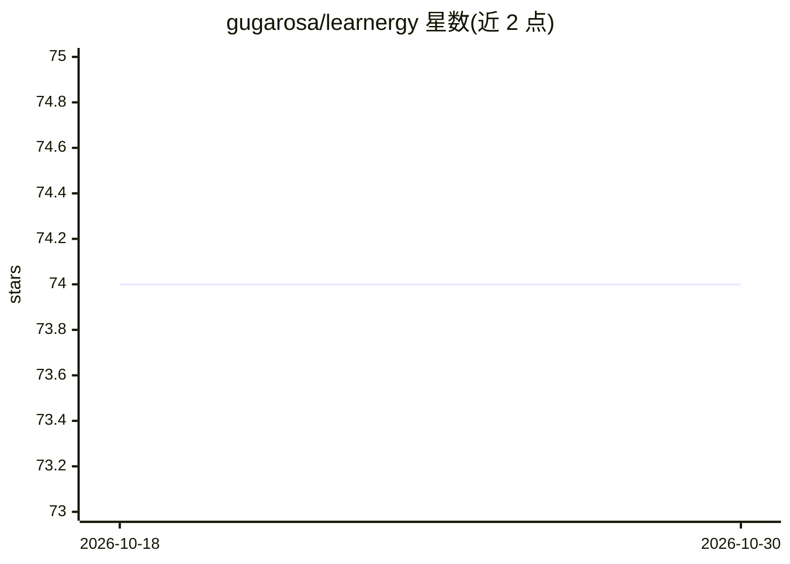

# gugarosa/learnergy

⭐ 74 · Python · Apache-2.0 · 推送 2026-10-24 · [GitHub](https://github.com/gugarosa/learnergy) · [官网](https://learnergy.readthedocs.io) · 个人维护

**基于 PyTorch 的 RBM/DBN 能量基模型 Python 库**

提供受限玻尔兹曼机（RBM）与深度信念网络（DBN）的 PyTorch 实现，覆盖 Bernoulli、Gaussian、卷积、判别式、Dropout/DropConnect 等多种变体，以及建模序列的循环时序变体（RTRBM/RTDBN）。支持无监督特征学习、生成建模与分类，并附带数据集适配器、SSIM 等图像质量指标与可视化工具。要求 Python 3.11+，通过 uv 或 pip 安装。面向使用 PyTorch 做能量基模型研究与实验的开发者与科研用户。

## 筛选速览

| 维度 | 判定 | 备注 |
|---|---|---|
| AI 角色 | `ai-native` | 本体是模型或模型工具 |
| 许可风险 | `permissive` | Apache-2.0 |
| 部署形态 | `library` | 以包/库形式分发 |
| 模型依赖 | — | README 未给出锁定关系 |
| 硬件要求 | — | 无带数字的原话,不猜 |
| 安装摩擦 | `low` | 无编译、无系统依赖或容器化 |
| 成熟度 | — | 结构信号不足 |

## 能力要点

- 20+ 种 RBM/DBN 模型变体（Bernoulli/Gaussian/卷积/判别式/Dropout 等）
- 带隐状态递归的时序模型（RTRBM/RTDBN）处理序列数据
- 包含数据集适配器、SSIM/缩放工具与收敛图等可视化辅助
- 文档中明确说明高斯归一化的批统计行为与采样数值约定

## 适用场景

- 用 RBM/DBN 做无监督特征学习或降维
- 训练生成模型或构建深度信念网络进行分类
- 用时序 RBM 建模带递归隐状态的序列数据

## 场景标签

 · 领域:机器学习/科研工具

## 证据(README 行号)

> L8: Learnergy provides PyTorch implementations of Restricted Boltzmann Machines
> L9: (RBMs) and Deep Belief Networks (DBNs) for unsupervised feature learning,

## 星数曲线

2026-10-18 74 → 2026-10-30 74（+0）

---
*卡片 v1 · prompt 1.4 · 生成 2026-10-24 · 置信度 high · 依据 README sha `20e48d66167a` · [字段定义](../../DATASET.md)*
