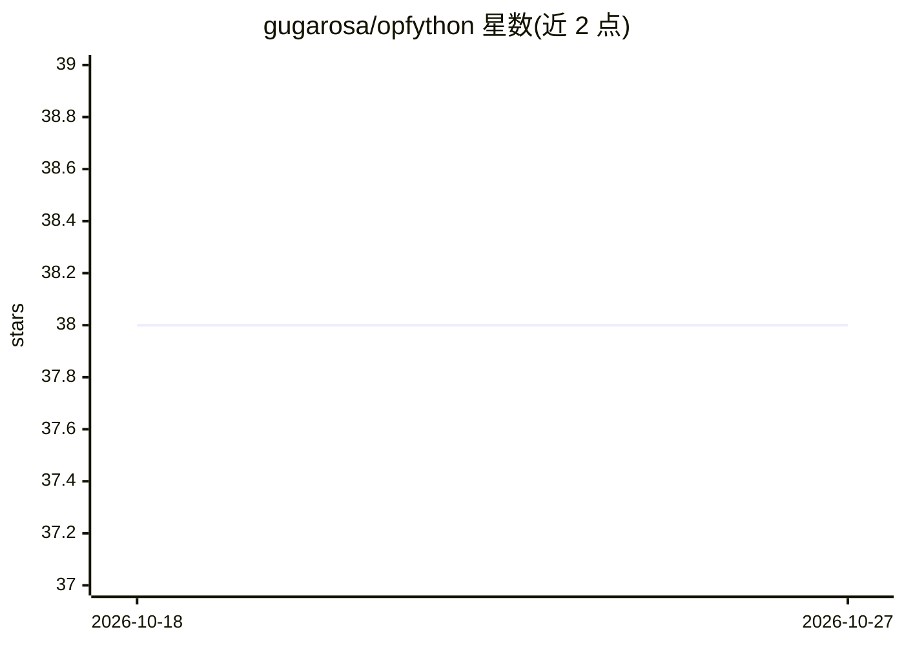

# gugarosa/opfython

⭐ 38 · Python · Apache-2.0 · 推送 2026-10-25 · [GitHub](https://github.com/gugarosa/opfython) · [官网](https://opfython.readthedocs.io) · 个人维护

**最优路径森林（OPF）分类器的 Python 实现库**

用 Python 实现 Optimum-Path Forest 家族分类器，提供监督、半监督、无监督与 KNN 监督四类模型，底层基于 NumPy 与 Numba 加速，实现遵循 LibOPF。附带 47 种距离度量、数据集加载与切分工具、评估指标及 LibOPF 二进制数据转换器。要求 Python 3.11+，支持预计算距离矩阵；标签须为零基连续，样本数不匹配抛出 SizeError。通过 pip 或 uv 安装，用于研究与机器学习开发。

## 筛选速览

| 维度 | 判定 | 备注 |
|---|---|---|
| AI 角色 | `ai-native` | 本体是模型或模型工具 |
| 许可风险 | `permissive` | Apache-2.0 |
| 部署形态 | `library` | 以包/库形式分发 |
| 模型依赖 | — | README 未给出锁定关系 |
| 硬件要求 | — | 无带数字的原话,不猜 |
| 安装摩擦 | `low` | 无编译、无系统依赖或容器化 |
| 成熟度 | — | 结构信号不足 |

## 能力要点

- 监督/半监督/无监督/KNN 监督四类 OPF 模型
- 47 种距离度量与 LibOPF 二进制数据集转换器
- 预计算距离矩阵支持（pre_computed_distance 参数）
- NumPy + Numba 后端实现

## 适用场景

- 在 Python 项目中使用 OPF 算法做监督分类或聚类
- 复用 LibOPF 二进制数据集并评估 OPF 模型
- 科研场景下引用并对比 OPF 分类器效果

## 场景标签

 · 领域:机器学习/模式识别

## 证据(README 行号)

> L9: OPFython is a Python implementation of the Optimum-Path Forest family of
> L10: classifiers. It provides supervised, semi-supervised, unsupervised, and

## 星数曲线

2026-10-18 38 → 2026-10-27 38（+0）

---
*卡片 v1 · prompt 1.4 · 生成 2026-10-25 · 置信度 high · 依据 README sha `c5edb52fbbfd` · [字段定义](../../DATASET.md)*
