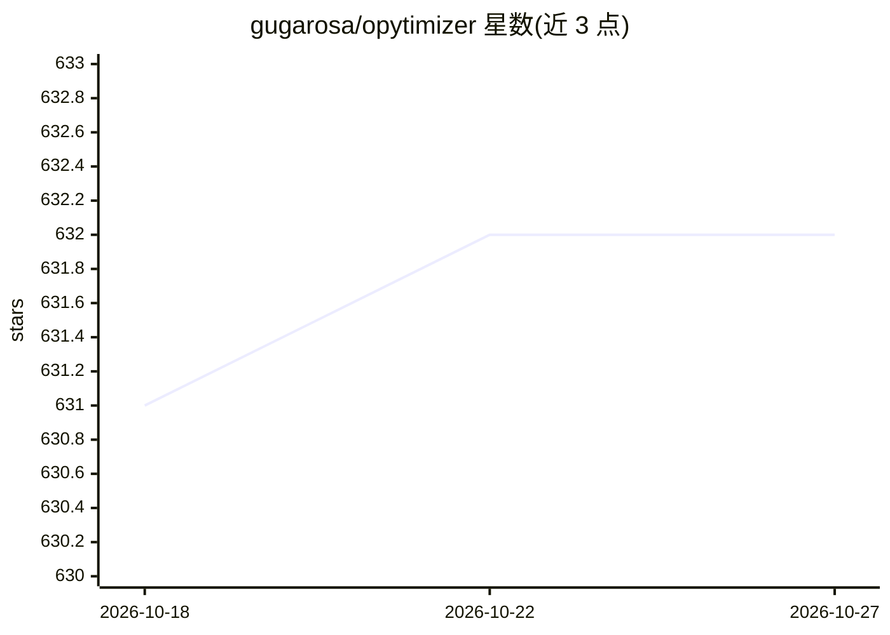

# gugarosa/opytimizer

⭐ 632 · Python · Apache-2.0 · 推送 2026-10-26 · [GitHub](https://github.com/gugarosa/opytimizer) · [官网](https://github.com/recogna-lab/opytimizer) · 组织维护

**自然启发的元启发式优化算法 Python 库**

提供多种元启发式（自然/生物启发）优化算法的 Python 库，用于求解优化问题。当前 README 为迁移公告：项目改由 Recogna Laboratory 维护并指向新仓库，原 README 仍可查看；本仓库另提供架构指南与文档源码说明当前 API 与开发流程。算法覆盖范围与安装方式需参阅原 README 及新仓库文档。

## 筛选速览

| 维度 | 判定 | 备注 |
|---|---|---|
| AI 角色 | `ai-native` | 本体是模型或模型工具 |
| 许可风险 | `permissive` | Apache-2.0 |
| 部署形态 | `None` |  |
| 模型依赖 | — | README 未给出锁定关系 |
| 硬件要求 | — | 无带数字的原话,不猜 |
| 安装摩擦 | `low` | 无编译、无系统依赖或容器化 |
| 成熟度 | — | 结构信号不足 |

## 能力要点

- 自然启发的元启发式优化算法集合
- 以 Python 库形式提供
- 提供架构指南与文档源码

## 适用场景

- 在 Python 中调用元启发式算法求解优化问题
- 作为优化器组件嵌入研究或工程流程

## 场景标签

 · 领域:优化算法/计算智能

## 证据(README 行号)

> L1: # Opytimizer: A Nature-Inspired Python Optimizer
> L3: ⚠️ This project is now maintained by the Recogna Laboratory.

## 星数曲线

2026-10-18 631 → 2026-10-27 632（+1）

---
*卡片 v1 · prompt 1.4 · 生成 2026-10-21 · 置信度 mid · 依据 README sha `d8e8f8b4565c` · [字段定义](../../DATASET.md)*
