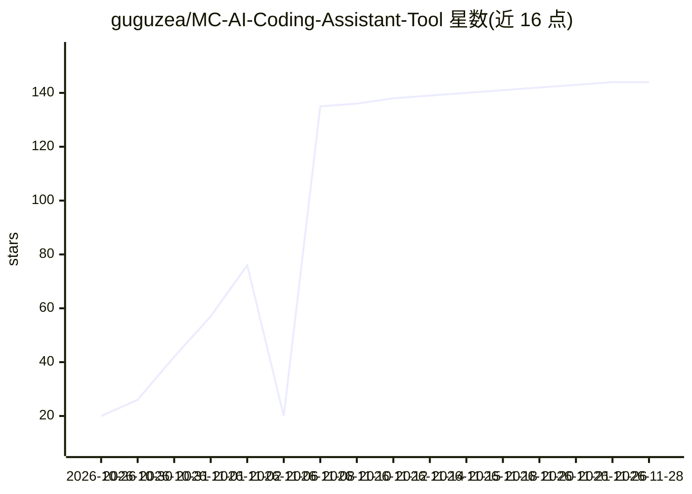

# guguzea/MC-AI-Coding-Assistant-Tool

⭐ 144 · HTML · NOASSERTION · 推送 2026-11-23 · [GitHub](https://github.com/guguzea/MC-AI-Coding-Assistant-Tool) · 个人维护 · 中文 README

**本地 MCP 工具库，让 AI 编程助手正确编写 Minecraft 模组**

以 MCP 服务器 + CLI 形式在本地运行的知识/工具库，供 Cursor、Claude Code 等 AI 编程助手接入。提供 8 个模组加载器与 2 个服务端面的逐版规则、官方文档向量检索、六层映射互转、崩溃日志分析、48 个库模组 API 摘要、脚手架与跨版本移植工作流、反编译解析及游戏内自测流程，共 89 个工具。前置要求 Node.js >= 22.5（部分版本需 --experimental-sqlite），写盘等操作要求用户确认（人在环）。

## 筛选速览

| 维度 | 判定 | 备注 |
|---|---|---|
| AI 角色 | `ai-ecosystem` | LLM/agent 周边工具 |
| 许可风险 | `none` | NOASSERTION |
| 部署形态 | `desktop` | 安装包/桌面程序 |
| 模型依赖 | — | README 未给出锁定关系 |
| 硬件要求 | — | 无带数字的原话,不猜 |
| 安装摩擦 | `medium` | 含编译或系统依赖之一 |
| 成熟度 | — | 结构信号不足 |

## 能力要点

- 覆盖 Forge/Fabric/NeoForge/Quilt/LiteLoader/Rift/ModLoader/基岩 + Paper/Spigot 的逐版规则与文档数据
- 官方文档原文向量检索与六层映射（mojang/mcp/yarn/parchment/obfuscated/intermediary）互转
- 崩溃日志分析、跨版本移植路径分析与移植工作流
- 客户端/服务端 driver 真机自测，产出截图、qa.log、state.json

## 适用场景

- 让 Cursor/Claude Code 按我工程的精确版本查 API、生成模组代码
- 把只有 Forge 版的模组移植到 Fabric
- 把 crash-report 扔给 AI 解析崩溃原因
- 查基岩版/Paper 服务端文档时避免 AI 编造 API

## 场景标签

`代码生成` `知识库管理` · 领域:编码与开发

## 证据(README 行号)

> L5: ### 一个跑在本地的 MCP知识/工具库：一站式MC模组解决方案
> L45:  Agent 会自己认宿主 → 检查 Node → `cd mcp-server && npm ci && npm run build` → 按该宿主格式生成配置草稿；**它先把目标文件与 diff 给你看，你确认后它才写**（不
> L48: **前置要求**：**Node.js >= 22.5**（`node -v` 自查）。**22.5–22.12 与 23.0–23.3 必须加 `--experimental-sqlite` 启动**——内置 `node:sqli

## 星数曲线

2026-10-26 20 → 2026-11-28 144（+124）

---
*卡片 v1 · prompt 1.4 · 生成 2026-11-27 · 置信度 high · 依据 README sha `11116b6dd0e6` · [字段定义](../../DATASET.md)*
