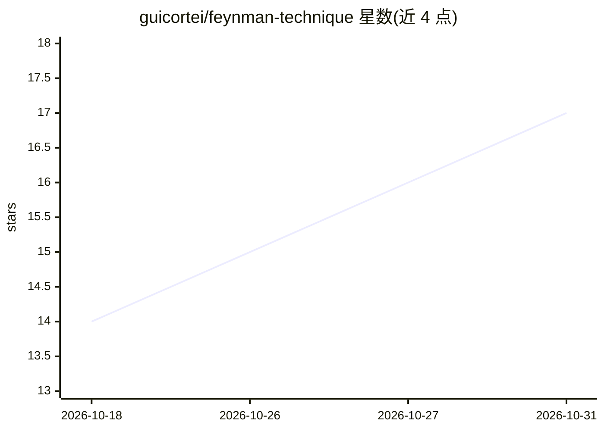

# guicortei/feynman-technique

⭐ 17 · Python · NOASSERTION · 推送 2026-07-31 · [GitHub](https://github.com/guicortei/feynman-technique) · [官网](https://dev.to/guicortei/feynman-never-wrote-basically-i-checked-all-88000-words-58bd) · 个人维护 · 中文 README

**让 AI 用费曼式方法解释概念的 Agent Skill**

面向 Claude Code、ChatGPT、Cursor、Copilot、Gemini CLI 等支持 Agent Skills 标准的工具的技能包：核心是 SKILL.md（纯 Markdown 提示文件），使模型输出遵循费曼式解释——机制先于名词、单一主类比并标明其失效边界、按厨房桌到专家的分层结构组织。方法从约 8.8 万字费曼一手文本中提炼。另提供 coach 模式（由用户解释、AI 定位漏洞）及安装脚本与多语言回答支持。

## 筛选速览

| 维度 | 判定 | 备注 |
|---|---|---|
| AI 角色 | `ai-knowledge` | 知识聚合/清单类 |
| 许可风险 | `permissive` | NOASSERTION |
| 部署形态 | `None` |  |
| 模型依赖 | — | README 未给出锁定关系 |
| 硬件要求 | — | 无带数字的原话,不猜 |
| 安装摩擦 | `low` | 无编译、无系统依赖或容器化 |
| 成熟度 | — | 结构信号不足 |

## 能力要点

- 基于约 8.8 万字费曼一手文本提炼解释方法
- 机制先行、主类比带失效边界、多层级讲解结构
- coach 模式：用户解释、AI 定位理解漏洞
- 纯 Markdown，可作为系统提示用于任意 AI

## 适用场景

- 让 Claude Code/ChatGPT 等工具用费曼式方法解释技术概念
- 通过 quiz 模式检验自己对知识的真实理解
- 将 SKILL.md 粘贴为系统提示用于不支持技能的 AI

## 场景标签

`提示工程` · 领域:Agent 开发

## 证据(README 行号)

> L59: It was built from primary sources, not from blog posts about him. Around **88,000 words**
> L96: One folder. Works in any tool that supports the
> L219: It's plain Markdown, so it works as a system prompt anywhere.

## 星数曲线

2026-10-18 14 → 2026-10-31 17（+3）

---
*卡片 v1 · prompt 1.4 · 生成 2026-10-30 · 置信度 high · 依据 README sha `497342962e65` · [字段定义](../../DATASET.md)*
