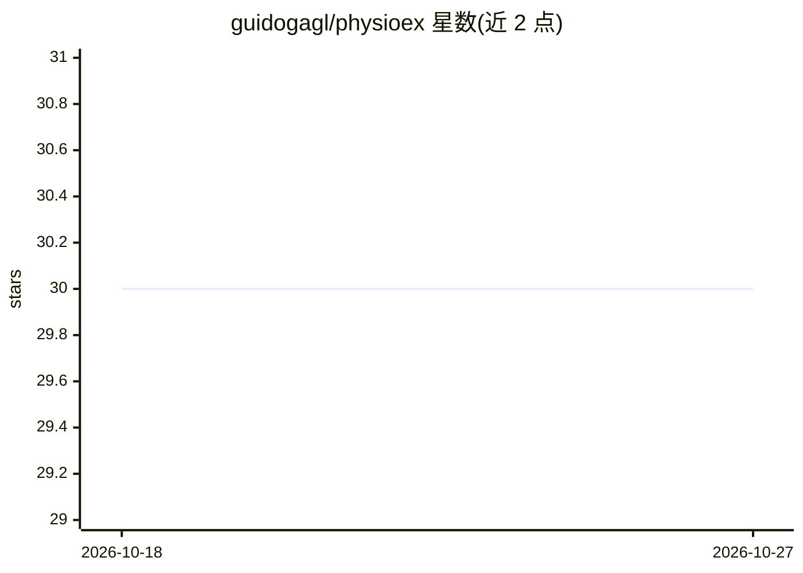

# guidogagl/physioex

⭐ 30 · Python · MIT · 推送 2026-10-16 · [GitHub](https://github.com/guidogagl/physioex) · [官网](https://guidogagl.github.io/physioex/) · 组织维护

**生理信号深度学习分类器的训练与可解释性 PyTorch 库**

面向生理信号（PSG/EEG 等）分析的 PyTorch 库：内置 8 种经典睡眠分期架构与 9 个预训练基础编码器（CBraMod、BENDR、LaBraM 等），提供统一接口抽取嵌入、线性探测与训练；通过 train/finetune/test_model 命令复现实验流程。可解释性工具包提供梯度归因、概念/原型方法及 Layer-wise Relevance Propagation。按名称解析 13 个公开与 NSRR 数据集，读取原始 EDF 记录并惰性预处理。以 pip 或源码方式安装。

## 筛选速览

| 维度 | 判定 | 备注 |
|---|---|---|
| AI 角色 | `ai-native` | 本体是模型或模型工具 |
| 许可风险 | `permissive` | MIT |
| 部署形态 | `library` | 以包/库形式分发 |
| 模型依赖 | — | README 未给出锁定关系 |
| 硬件要求 | — | 无带数字的原话,不猜 |
| 安装摩擦 | `medium` | 含编译或系统依赖之一 |
| 成熟度 | — | 结构信号不足 |

## 能力要点

- 8 种睡眠分期架构 + 9 个预训练基础编码器统一接口
- 梯度归因、概念/原型与 LRP 可解释性工具包
- 13 个数据集（含 NSRR、阿尔茨海默/帕金森数据）按名称解析
- train/finetune/test_model CLI 复现实验流程

## 适用场景

- 在标准数据集上训练并评测睡眠分期模型
- 对生理信号分类模型做归因与可解释性分析
- 用预训练编码器抽取嵌入或做线性探测

## 场景标签

`模型训练` `微调` `模型评测` · 领域:评测与运维

## 证据(README 行号)

> L8: **PhysioEx ( Physiological Signal Explainer )** is a versatile python library tailored for building, training, and e
> L18: The explainability toolkit (`physioex.explain`) offers gradient-based attribution
> L14: Beyond training classic architectures from scratch, PhysioEx wraps a family of

## 星数曲线

2026-10-18 30 → 2026-10-27 30（+0）

---
*卡片 v1 · prompt 1.4 · 生成 2026-10-26 · 置信度 high · 依据 README sha `49ce38fcaf9e` · [字段定义](../../DATASET.md)*
