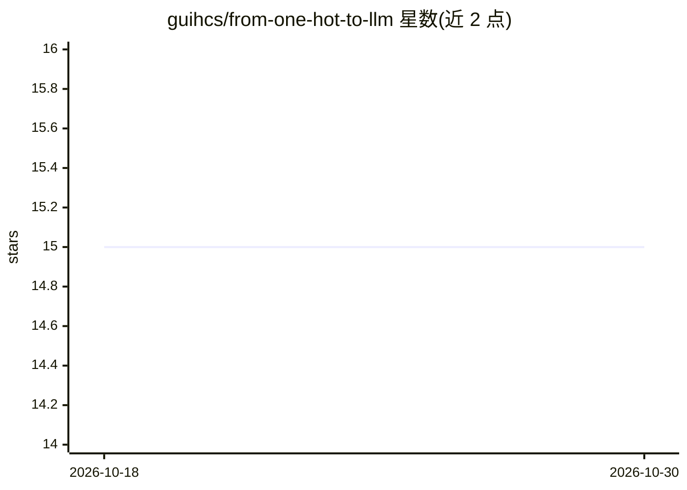

# guihcs/from-one-hot-to-llm

⭐ 15 · Jupyter Notebook · MIT · 推送 2026-06-06 · [GitHub](https://github.com/guihcs/from-one-hot-to-llm) · 个人维护

**从 N-gram 到 Transformer 的语言模型入门课程**

面向学习者的实践型课程仓库，以 Jupyter Notebook 形式分四章讲解语言建模：N-gram 马尔可夫模型、深度学习基础、神经语言建模（词嵌入与 RNN）、Transformer 架构。章节文件位于 chap0–chap3 目录，代码需按顺序执行并可实验。安装方式为 git clone 源码后用 UV 或 pip 安装依赖，再运行 jupyter notebook，也支持在 Colab 中打开；要求 Python 3.9+。MIT 许可，接受社区贡献。

## 筛选速览

| 维度 | 判定 | 备注 |
|---|---|---|
| AI 角色 | `ai-knowledge` | 知识聚合/清单类 |
| 许可风险 | `permissive` | MIT |
| 部署形态 | `None` |  |
| 模型依赖 | — | README 未给出锁定关系 |
| 硬件要求 | — | 无带数字的原话,不猜 |
| 安装摩擦 | `low` | 无编译、无系统依赖或容器化 |
| 成熟度 | — | 结构信号不足 |

## 能力要点

- 四个章节 Notebook：N-gram、深度学习、神经语言建模、Transformer
- 配套代码单元可顺序执行与实验
- 支持 UV/pip 安装依赖与 Colab 打开

## 适用场景

- 系统学习从统计语言模型到 LLM 的基础概念
- 通过动手代码理解 Transformer 与神经语言建模
- 作为 AI 入门课程的自学材料

## 场景标签

`教程课程` · 领域:学习与行业

## 证据(README 行号)

> L9: This course provides a hands-on introduction to language modeling and AI, designed to help you understand the fundam
> L11: ## 📖 Course Contents

## 星数曲线

2026-10-18 15 → 2026-10-30 15（+0）

---
*卡片 v1 · prompt 1.4 · 生成 2026-10-30 · 置信度 high · 依据 README sha `c8f91534f7e9` · [字段定义](../../DATASET.md)*
