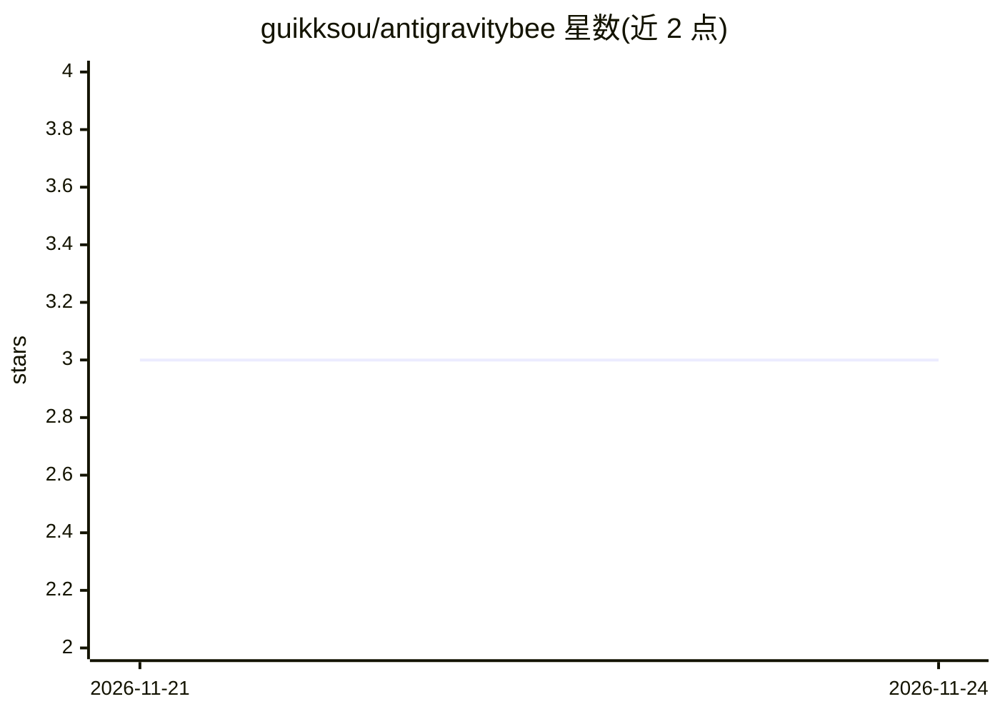

# guikksou/antigravitybee

⭐ 4 · Python · 推送 2026-11-20 · [GitHub](https://github.com/guikksou/antigravitybee) · 个人维护

**Google Antigravity 的像素风桌面宠物挂件，实时同步 agent 状态**

面向 Google Antigravity（CLI、IDE 与 Antigravity 2.0）的桌面覆盖层挂件，以置顶窗口形式运行，通过 Antigravity 生命周期钩子（hooks.json）与 transcript.jsonl 尾随读取，在本地实时反映 agent 的思考、读文件、改代码、跑终端、编排子代理、等待输入、完成等状态，全程不消耗 token。提供 4 档像素缩放、鼠标视线跟随、抚摸检测、点击确认提醒、Ghost 半透明模式。作为 Antigravity 插件以 git clone 方式安装，支持全局或单项目两种安装位置。

## 筛选速览

| 维度 | 判定 | 备注 |
|---|---|---|
| AI 角色 | `ai-enhanced` | 去掉 AI 部分产品仍成立 |
| 许可风险 | `none` | — |
| 部署形态 | `None` |  |
| 模型依赖 | — | README 未给出锁定关系 |
| 硬件要求 | — | 无带数字的原话,不猜 |
| 安装摩擦 | `low` | 无编译、无系统依赖或容器化 |
| 成熟度 | — | 结构信号不足 |

## 能力要点

- 通过 lifecycle hooks 与 transcript.jsonl 尾随实现零 token 的状态同步
- 区分思考/阅读/编码/终端/多代理等工作状态与等待输入/完成/空闲通知状态
- 4 档整数像素缩放、鼠标视线跟随、抚摸检测与拖拽物理效果
- Wayland 下自动切换 GTK3/Cairo 后端实现逐像素透明

## 适用场景

- 编写 agent 任务时在桌面实时查看当前执行阶段
- 需要用户审批时通过桌面挂件及时收到提醒
- 以桌面宠物形式展示 agent 运行状态

## 场景标签

 · 领域:开发者工具/桌面工具

## 证据(README 行号)

> L5: A lightweight, 60-FPS pixel-art desktop overlay for Google Antigravity (CLI, IDE, and Antigravity 2.0) on Windows an
> L7: It runs as an always-on-top desktop widget and reacts in real time (with zero token overhead) to the agent's executi
> L11: - **Zero-Token Lifecycle Synchronization**

## 星数曲线

2026-11-21 3 → 2026-11-24 3（+0）

---
*卡片 v1 · prompt 1.4 · 生成 2026-11-22 · 置信度 high · 依据 README sha `c241084c8941` · [字段定义](../../DATASET.md)*
