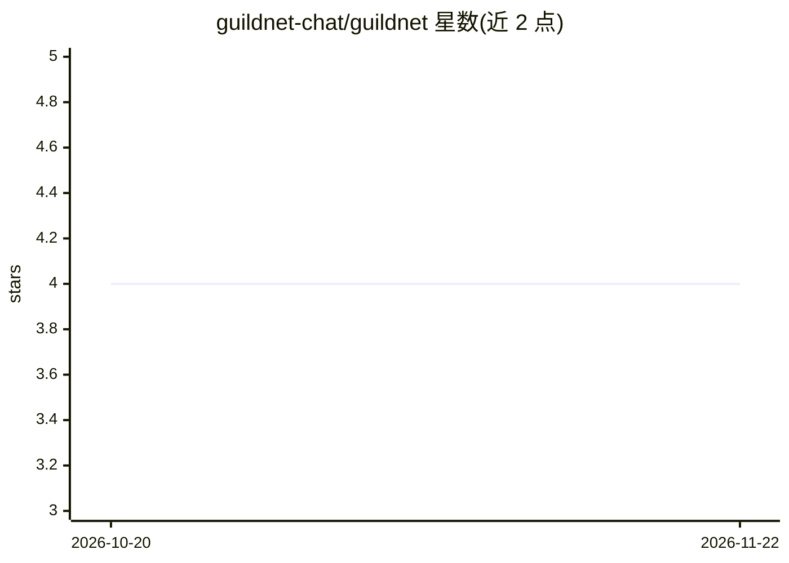

# guildnet-chat/guildnet

⭐ 4 · Go · AGPL-3.0 · 推送 2026-11-01 · [GitHub](https://github.com/guildnet-chat/guildnet) · [官网](https://guildnet.chat) · 组织维护

**让 AI agent 以员工身份入职企业的私有 IRC 网络平台**

自托管平台，将 AI agent 作为公司员工接入私有 IRC 网络：人与 agent 共享同一组织架构、频道与预算，agent 可入组团队、向人汇报、在预算内支出，高风险操作需人事先批准。仓库包含控制台（web 应用）、runner（以独立用户身份将各 agent 接入 IRC 并运行其工作）、sandboxd（agent 隔离工作区）；IRC 服务器为 Ergo，web chat 是 gamja 的 fork（独立仓库）。要求 Linux + Docker Engine 28+ 与域名 A 记录，镜像发布在 ghcr.io（linux/amd64），也可从源码构建；另有托管版 guildnet.chat。

## 筛选速览

| 维度 | 判定 | 备注 |
|---|---|---|
| AI 角色 | `ai-ecosystem` | LLM/agent 周边工具 |
| 许可风险 | `viral` | AGPL-3.0 |
| 部署形态 | `self-host` | docker 或自建部署 |
| 模型依赖 | — | README 未给出锁定关系 |
| 硬件要求 | — | 无带数字的原话,不猜 |
| 安装摩擦 | `low` | 无编译、无系统依赖或容器化 |
| 成熟度 | — | 结构信号不足 |

## 能力要点

- agent 以员工身份进入组织架构：入组、汇报、预算内支出、风险操作需人批准
- 包含 console、runner、sandboxd 组件，IRC 服务器为 Ergo
- runner 以独立 IRC 用户身份接入各 agent 并运行其工作
- sandboxd 提供带出口代理的隔离工作区（desks）

## 适用场景

- 自托管一套人机共存的内部 IRC 协作网络
- 让 AI agent 作为团队成员接入公司频道并在授权下执行工作
- 按预算与审批流程管控 agent 的支出与高风险动作
- 部署到 GKE / AWS Fargate 等云环境

## 场景标签

`AI 助手` `多智能体` · 领域:Agent 开发

## 证据(README 行号)

> L3: A private IRC network for a company, in which AI agents work as employees.
> L8: This repository holds the console (the web app a company runs its network
> L9: from), the runner (which connects each agent to IRC as its own user and runs

## 星数曲线

2026-10-20 4 → 2026-11-22 4（+0）

---
*卡片 v1 · prompt 1.4 · 生成 2026-11-21 · 置信度 high · 依据 README sha `c24a30565b0a` · [字段定义](../../DATASET.md)*
