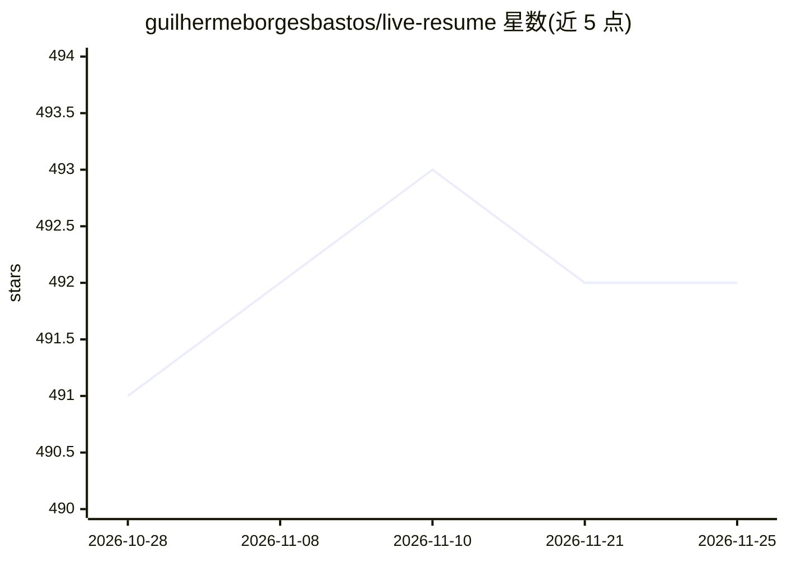

# guilhermeborgesbastos/live-resume

⭐ 492 · TypeScript · MIT · 推送 2026-11-02 · [GitHub](https://github.com/guilhermeborgesbastos/live-resume) · [官网](https://guilhermeborgesbastos.com/) · 个人维护

**求职者搭建带 AI 问答助手的专业个人简历网站**

基于 Angular 21 的开源个人网站/简历模板，提供 5 个自定义板块、移动端响应式、英/葡双语国际化、SEO 优化、Google Analytics 与 Firebase 联系表单。内置规则式 AI 助手：仅从本地 JSON 数据组装回答并标注来源，对话仅存于当前标签页内存。可选启用 Firebase Cloud Function 调用 Claude API 生成兜底回答，带 App Check 与调用频率限制，默认关闭。提供 Docker 镜像、Playwright E2E 测试与 CI 工作流。

## 筛选速览

| 维度 | 判定 | 备注 |
|---|---|---|
| AI 角色 | `ai-enhanced` | 去掉 AI 部分产品仍成立 |
| 许可风险 | `permissive` | MIT |
| 部署形态 | `self-host` | docker 或自建部署 |
| 模型依赖 | — | README 未给出锁定关系 |
| 硬件要求 | — | 无带数字的原话,不猜 |
| 安装摩擦 | `low` | 无编译、无系统依赖或容器化 |
| 成熟度 | — | 结构信号不足 |

## 能力要点

- 规则式 AI 助手在浏览器本地运行，回答仅来自 JSON 数据并引用来源
- 可选 Claude API 云函数兜底回答，带 App Check 与每日/月度/单访客限额
- Angular 21 应用，支持英/葡双语构建、SEO 结构化数据与移动手势
- Dockerfile 构建镜像发布至 Docker Hub（amd64/arm64）

## 适用场景

- 为自己搭建可分享到 WhatsApp/LinkedIn 的在线简历网站
- 让访客通过 AI 助手提问了解你的经历与文章
- 需要中英（此处为英/葡）多语言简历站点时配置双语构建

## 场景标签

`AI 助手` · 领域:对话与助手

## 证据(README 行号)

> L14: Get rid of your old and deprecated text resume by using the first **Open-source Web Application** _(100% free)_, wh
> L135: Visitors can ask questions about the CV from the floating **Ask my AI Assistant** button (shown with a robot icon)
> L137: Optionally, questions the rule-based assistant can't answer can go to **AI answers**: a Firebase Cloud Function (`

## 星数曲线

2026-10-28 491 → 2026-11-25 492（+1）

---
*卡片 v1 · prompt 1.4 · 生成 2026-11-25 · 置信度 high · 依据 README sha `153b74cdfd4d` · [字段定义](../../DATASET.md)*
