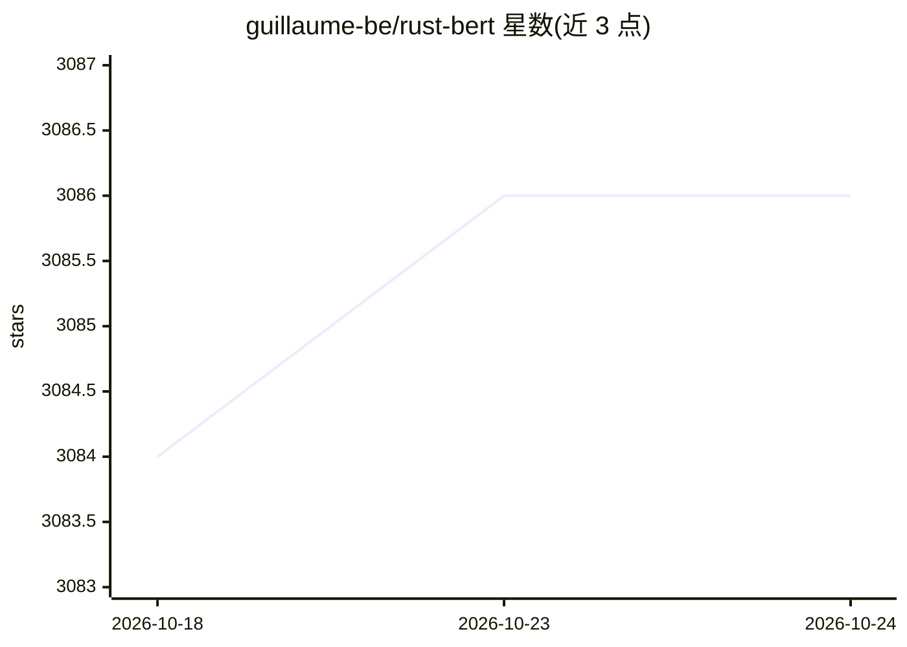

# guillaume-be/rust-bert

⭐ 3,086 · Rust · Apache-2.0 · 推送 2026-01-13 · [GitHub](https://github.com/guillaume-be/rust-bert) · [官网](https://docs.rs/crate/rust-bert) · 个人维护

**Rust 原生 NLP 模型与即用管线库：问答/翻译/摘要/生成等**

Hugging Face Transformers 的 Rust 移植库，通过 tch-rs（Libtorch 绑定）或可选 ONNX Runtime 运行 transformer 模型，预处理由 rust-tokenizers 提供，支持多线程分词与 GPU 推理。内置问答、命名实体识别、翻译、摘要、文本生成、多轮对话、零样本分类、句子嵌入等即用管线，覆盖 BERT、DistilBERT、RoBERTa、GPT2、T5、BART 等 20 余种架构。运行需安装 Libtorch v2.4（可自动下载），模型文件量为数百 MB 至 GB 级。面向希望以 Rust 直接产出 NLP 推理结果的开发者。

## 筛选速览

| 维度 | 判定 | 备注 |
|---|---|---|
| AI 角色 | `ai-native` | 本体是模型或模型工具 |
| 许可风险 | `permissive` | Apache-2.0 |
| 部署形态 | `desktop` | 安装包/桌面程序 |
| 模型依赖 | — | README 未给出锁定关系 |
| 硬件要求 | — | 无带数字的原话,不猜 |
| 安装摩擦 | `medium` | 含编译或系统依赖之一 |
| 成熟度 | — | 结构信号不足 |

## 能力要点

- 20 余种 transformer 架构与 11 类 NLP 任务的即用管线
- 基于 tch-rs/Libtorch 绑定，支持 GPU 推理与多线程分词
- 可选 ONNX 支持（ort 绑定，兼容 Optimum 导出模型）
- 翻译支持 Marian 双语模型与 M2M100 百语种模型

## 适用场景

- 在 Rust 服务中直接做问答、NER、情感分析等推理
- 用 GPT2/BART 生成文本或摘要，带 beam search、top-k 等采样控制
- 以 ONNX Runtime 后端运行导出的 transformer 模型

## 场景标签

`推理引擎` · 领域:训练与推理

## 证据(README 行号)

> L8: Rust-native state-of-the-art Natural Language Processing models and pipelines.
> L19: Get started with tasks including question answering, named entity recognition,
> L29: let answers = qa_model.predict( & [QaInput { question, context }], 1, 32);

## 星数曲线

2026-10-18 3,084 → 2026-10-24 3,086（+2）

---
*卡片 v1 · prompt 1.4 · 生成 2026-10-20 · 置信度 mid · 依据 README sha `4eee277d4cae` · [字段定义](../../DATASET.md)*
