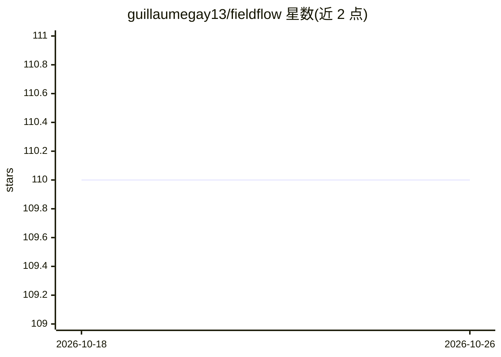

# guillaumegay13/fieldflow

⭐ 110 · Python · MIT · 推送 2026-07-22 · [GitHub](https://github.com/guillaumegay13/fieldflow) · [官网](https://fieldflow.dev) · 个人维护

**把 OpenAPI 规格的 REST API 转为字段过滤工具并暴露给 MCP 客户端**

读取 OpenAPI 3.0 JSON/YAML 规格文件，动态生成 Pydantic 模型与 FastAPI 路由，代理请求到上游 API 并按调用方指定的 fields 列表裁剪响应，支持嵌套字段选择器；可选 MCP 层通过 stdio 把生成的工具暴露给 Claude Desktop 等 MCP 客户端。另含 fieldflow-cli 包装 gh/gcloud/kubectl/aws 等 JSON 输出 CLI 以压缩 token，并附带 Claude Code 技能与 OpenAI agent 变体。限制：尚不能包装任意第三方 MCP 服务器。

## 筛选速览

| 维度 | 判定 | 备注 |
|---|---|---|
| AI 角色 | `ai-ecosystem` | LLM/agent 周边工具 |
| 许可风险 | `permissive` | MIT |
| 部署形态 | `library` | 以包/库形式分发 |
| 模型依赖 | — | README 未给出锁定关系 |
| 硬件要求 | — | 无带数字的原话,不猜 |
| 安装摩擦 | `low` | 无编译、无系统依赖或容器化 |
| 成熟度 | `idea` | |

## 能力要点

- 从 OpenAPI 规格动态生成 FastAPI 工具端点与 Pydantic 模型
- fields 参数按需裁剪响应，含 JSONPath-lite 嵌套选择器
- fieldflow-mcp 通过 stdio 向 MCP 客户端暴露生成工具
- fieldflow-cli 包装 JSON CLI 减少模型上下文占用

## 适用场景

- 让 LLM agent 以精简字段调用现有 REST API，控制 token 消耗
- 在 Claude Desktop 中通过 MCP 使用 OpenAPI 描述的服务
- 裁剪 gh/kubectl 等 CLI 的冗长 JSON 输出再交给模型

## 场景标签

`Agent 框架` · 领域:Agent 开发

## 证据(README 行号)

> L3: FieldFlow turns OpenAPI-described REST endpoints into selectively filtered tools. It generates Pydantic models and F
> L21: 1. `fieldflow serve-http` exposes generated HTTP tool endpoints from an OpenAPI spec.
> L22: 2. `fieldflow-mcp` exposes the same generated OpenAPI tools through MCP over stdio.

## 星数曲线

2026-10-18 110 → 2026-10-26 110（+0）

---
*卡片 v1 · prompt 1.4 · 生成 2026-10-23 · 置信度 high · 依据 README sha `42407593e942` · [字段定义](../../DATASET.md)*
