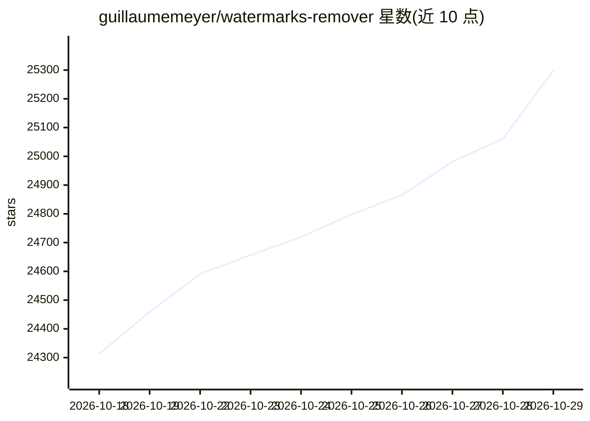

# guillaumemeyer/watermarks-remover

⭐ 25,298 · Python · MIT · 推送 2026-10-26 · [GitHub](https://github.com/guillaumemeyer/watermarks-remover) · [官网](https://github.com/guillaumemeyer/watermarks-remover) · 个人维护

**给内容所有者去除多厂商 AI 水印/溯源标记的 agent skill 与本地服务**

由 agent skill（纯 Markdown 薄客户端，经 HTTP 调用）与 Python stdlib 服务两部分组成，用于清除用户自有内容中的 AI 溯源标记。分三层：A 层确定性脚本清理不可见 Unicode/bidi/标签字符；B 层借助模型改写处理统计型文本水印（可选）；文件层读取 C2PA/EXIF/XMP/文档属性，覆盖 PNG、JPEG、PDF、DOCX、MP4 等多种格式。支持安装到 Claude Code、Codex、Cursor、Grok 等宿主，并提供 Claude Code PostToolUse hook 与 pre-commit 门禁实现确定性清理。需 Python 3.10+；hook 无法改写聊天消息本身。

## 筛选速览

| 维度 | 判定 | 备注 |
|---|---|---|
| AI 角色 | `ai-ecosystem` | LLM/agent 周边工具 |
| 许可风险 | `permissive` | MIT |
| 部署形态 | `self-host` | docker 或自建部署 |
| 模型依赖 | locked-api |  |
| 硬件要求 | — | 无带数字的原话,不猜 |
| 安装摩擦 | `low` | 无编译、无系统依赖或容器化 |
| 成熟度 | — | 结构信号不足 |

## 动量与使用信号

- 维护:`active` — 距上次 push 1.1 天,年发版 9,53 位贡献者
- 涨星:近 1 天 **+94**(自 20261016 起算)
- 安装:pypi 包 `pytest` 月下载 761,970,029
- 平台:WINDOWS / MACOS / LINUX · 协议:OPENAI-API / OLLAMA

## 能力要点

- 三层清理：不可见 Unicode（确定性脚本）、统计型文本水印（模型改写）、文件元数据（C2PA/EXIF/XMP）
- skill 为无代码 HTTP 薄客户端，宿主无需 Python；服务仅需 Python 3.10+ stdlib 无依赖
- 支持 Claude Code/Codex/Cursor/Cowork/Grok 多宿主安装，含 Claude Code plugin marketplace 一键安装
- PostToolUse hook 提供确定性 check/clean 两种模式，并支持 pre-commit 门禁与 SARIF 导出

## 适用场景

- 清理自己用 AI 生成文档中的 C2PA 与 EXIF 元数据
- 在 Claude Code 中通过 hook 自动检测/清理 agent 写出文件中的溯源标记
- git 提交前用 pre-commit 门禁拦截带水印文件
- 为 claude.ai/Cowork 云会话打包上传自包含的纯文本清理 skill

## 场景标签

 · 领域:内容安全/隐私工具

## 证据(README 行号)

> L14: Agent skill + stdlib Python service to strip **multi-vendor AI provenance marks** from text and files — for privacy
> L37: (Python 3.10+ stdlib, no dependencies):
> L22: Vendors / ecosystems (class-level): **Claude**, **Gemini / SynthID-Text**, **OpenAI** provenance surfaces, **open-L

## 星数曲线

2026-10-18 24,313 → 2026-10-29 25,298（+985）

---
*卡片 v1 · prompt 1.4 · 生成 2026-10-18 · 置信度 mid · 依据 README sha `3b57560c781d` · [字段定义](../../DATASET.md)*
