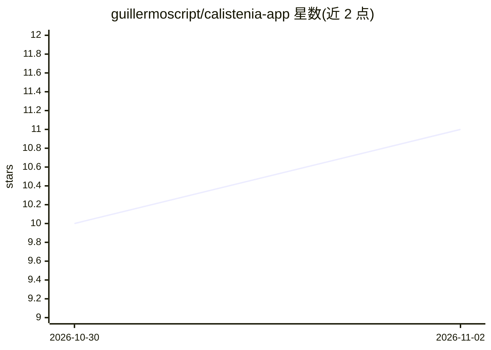

# guillermoscript/calistenia-app

⭐ 11 · TypeScript · MIT · 推送 2026-11-01 · [GitHub](https://github.com/guillermoscript/calistenia-app) · [官网](https://gym.guille.tech) · 个人维护

**自托管 AI 教练健身应用：训练、营养与进度一站式记录**

React Native（Expo）+ Web PWA 的街健健身应用，核心功能含 15 套结构化训练计划与技能路线图、逐组训练记录、休息与等长计时器、GPS 跑步（MapLibre）、饮食与宏量营养记录、社交与游戏化激励；内置 AI 教练用于生成个性化计划与营养评分，通过独立 MCP server 提供。后端为自托管 PocketBase（SQLite，30+ 集合，迁移驱动），数据本地离线回退，MIT 许可。需 Node 20+ 与 pnpm 10+ 从源码运行，Web 与后端打包为单一 Docker 镜像部署。

## 筛选速览

| 维度 | 判定 | 备注 |
|---|---|---|
| AI 角色 | `ai-enhanced` | 去掉 AI 部分产品仍成立 |
| 许可风险 | `permissive` | MIT |
| 部署形态 | `self-host` | docker 或自建部署 |
| 模型依赖 | — | README 未给出锁定关系 |
| 硬件要求 | — | 无带数字的原话,不猜 |
| 安装摩擦 | `low` | 无编译、无系统依赖或容器化 |
| 成熟度 | — | 结构信号不足 |

## 能力要点

- 15 套结构化训练计划与街健技能路线图（引体/倒立/双力臂/俄挺）
- AI 教练生成个性化计划与营养评分，经 MCP server 提供
- GPS 跑步、饮食宏量记录、社交评论与游戏化激励
- PocketBase 自托管，单一 Docker 镜像部署，离线本地存储回退

## 适用场景

- 按结构化计划练街健并逐组记录训练
- 记录饮食热量与宏量并获取 AI 营养反馈
- 自托管掌控自己的训练与饮食数据

## 场景标签

 · 领域:健康与健身

## 证据(README 行号)

> L5: Train with a structured calisthenics program, log every set, track your nutrition, run cardio with live GPS, and let
> L24: - **🤖 AI coach built in** — get a personalized plan, ask questions, and let the app adjust your training and nutrit
> L64: |**AI / MCP** (`mcp-server`)|MCP server + AI API for the coach and smart tools|

## 星数曲线

2026-10-30 10 → 2026-11-02 11（+1）

---
*卡片 v1 · prompt 1.4 · 生成 2026-11-02 · 置信度 high · 依据 README sha `e0acc4c81b74` · [字段定义](../../DATASET.md)*
