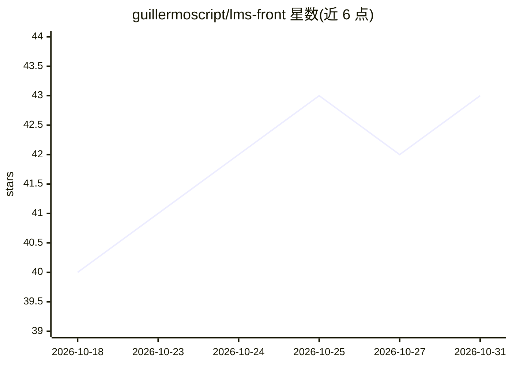

# guillermoscript/lms-front

⭐ 43 · TypeScript · MIT · 推送 2026-10-30 · [GitHub](https://github.com/guillermoscript/lms-front) · [官网](https://preciopana.com) · 个人维护

**面向创作者与学校的多租户开源 LMS，可自托管售卖课程**

基于 Next.js 16 + React 19 + Supabase（Postgres + RLS）+ Stripe Connect 的多租户学习管理系统：每个学校获得独立子域名与品牌，通过 Postgres 行级安全隔离数据。功能覆盖块编辑器课程、考试（含 AI 辅助评分）、FSRS 间隔重复、XP/等级/联赛等游戏化、证书公开验证，以及通过 MCP 服务器向任意 MCP 客户端暴露 AI 导师工具（练习、弱项补课、备考就绪）。支付支持 Stripe Connect、PayPal、Solana、Binance 等。本地开发需 Node.js 20+、Docker 与 Supabase CLI，提供英文/西班牙文双语。

## 筛选速览

| 维度 | 判定 | 备注 |
|---|---|---|
| AI 角色 | `ai-enhanced` | 去掉 AI 部分产品仍成立 |
| 许可风险 | `permissive` | MIT |
| 部署形态 | `library` | 以包/库形式分发 |
| 模型依赖 | — | README 未给出锁定关系 |
| 硬件要求 | — | 无带数字的原话,不猜 |
| 安装摩擦 | `low` | 无编译、无系统依赖或容器化 |
| 成熟度 | — | 结构信号不足 |

## 能力要点

- 子域名级多租户，隔离由 Postgres RLS 强制而非应用代码
- MCP 服务器将 LMS 暴露为工具，任意 MCP 客户端可调用 AI 导师（Supabase OAuth 2.1 认证）
- Stripe Connect 平台抽成 + 收益分成，另支持 PayPal/Solana/Binance/线下收款
- 课程含考试 AI 辅助评分、FSRS 间隔重复与可公开验证的证书

## 适用场景

- 创作者或学校搭建自有品牌子域名的课程销售平台
- 自托管或 fork 一套多租户 Supabase + Next.js 架构参考
- 通过任意 MCP 客户端为学生提供 AI 导师与备考工具

## 场景标签

 · 领域:教育科技/在线课程平台

## 证据(README 行号)

> L3: **Open-source, multi-tenant LMS for creators and schools.** Every school gets its own subdomain (`school.platform.co
> L23: |**AI tutor**|An MCP server (`mcp-server/`) exposing the LMS as tools + interactive widgets: drill practice, weak-t

## 星数曲线

2026-10-18 40 → 2026-10-31 43（+3）

---
*卡片 v1 · prompt 1.4 · 生成 2026-10-25 · 置信度 high · 依据 README sha `dae0e3b05b9c` · [字段定义](../../DATASET.md)*
