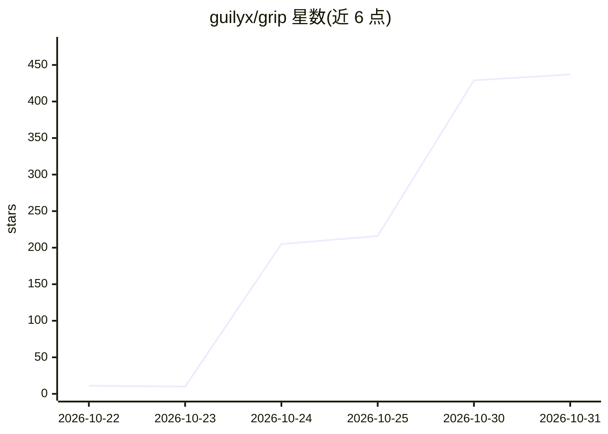

# guilyx/grip

⭐ 437 · Python · BSD-3-Clause · 推送 2026-10-28 · [GitHub](https://github.com/guilyx/grip) · [官网](https://guilyx.github.io/grip/) · 个人维护

**推送前拷问开发者的 git hook：用模型就 diff 出题并打分**

grip 是一个 git pre-push 钩子工具：读取本次变更的 diff，生成五个问题（为何这样设计、哪里会失败、恶意调用方会做什么等），由模型按隐藏评分标准打分（0-100），低于团队设定的分数线则阻止 push。附带 whiteboard 模式，在浏览器中以部件与箭头绘制变更并钉上问题。可复用已安装的 Claude Code、Codex、Gemini CLI 作为模型（无需 API key），也支持 Anthropic、OpenAI 兼容 API 与本地 Ollama；另提供 fake 离线脚本评分器供试用。

## 筛选速览

| 维度 | 判定 | 备注 |
|---|---|---|
| AI 角色 | `ai-native` | 本体是模型或模型工具 |
| 许可风险 | `permissive` | BSD-3-Clause |
| 部署形态 | `library` | 以包/库形式分发 |
| 模型依赖 | local-ok | 支持本地模型 |
| 硬件要求 | — | 无带数字的原话,不猜 |
| 安装摩擦 | `low` | 无编译、无系统依赖或容器化 |
| 成熟度 | — | 结构信号不足 |

## 能力要点

- 从 diff 生成五个问题并按隐藏评分标准打分，低于分数线阻止 push
- whiteboard 模式：浏览器中以部件与箭头绘制变更并钉上问题
- 复用 Claude Code / Codex / Gemini CLI 作为模型，或 Anthropic / OpenAI 兼容 API / Ollama
- 支持在编码代理内使用 /grip 命令并在通过前阻止代理推送

## 适用场景

- 我想在推送前确认自己真的理解并能为 AI 生成的代码辩护
- 团队希望在 .grip.toml 中共享统一的及格分数与难度标准
- 想在编码代理工作流中加一道人工理解门槛

## 场景标签

`代码审查` · 领域:编码与开发

## 证据(README 行号)

> L13: Before your code leaves your machine, grip reads the diff and asks you about it: why it is
> L41: - **Five questions from your diff**, graded against a hidden rubric into a Grip Score out

## 星数曲线

2026-10-22 11 → 2026-10-31 437（+426）

---
*卡片 v1 · prompt 1.4 · 生成 2026-10-23 · 置信度 high · 依据 README sha `b0d17a1e127b` · [字段定义](../../DATASET.md)*
