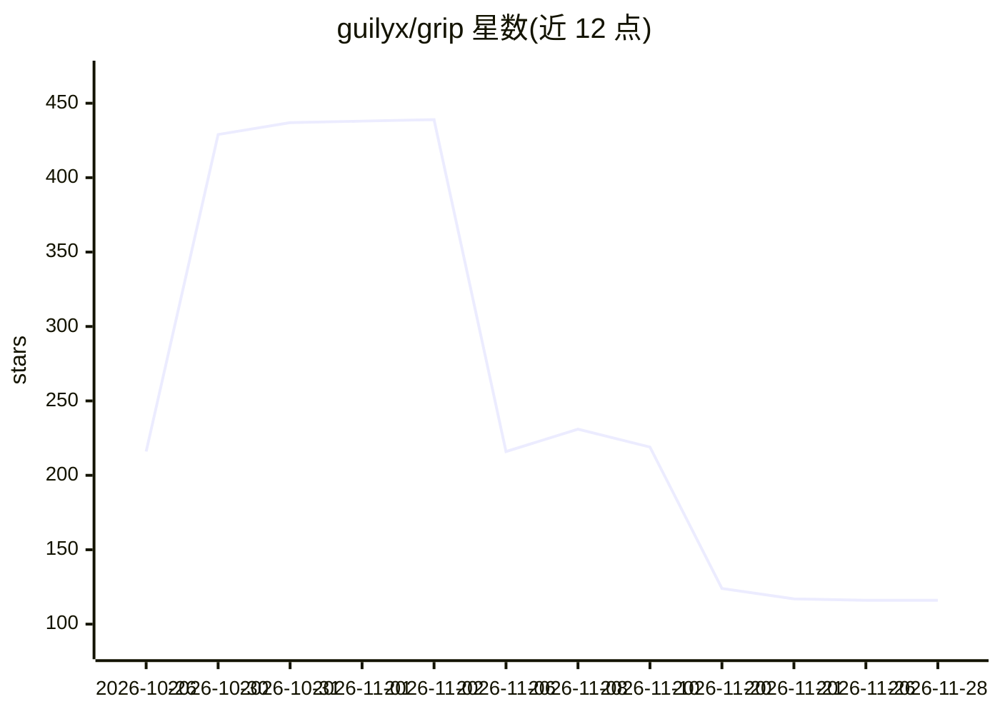

# guilyx/grip

⭐ 116 · Python · BSD-3-Clause · 推送 2026-10-28 · [GitHub](https://github.com/guilyx/grip) · [官网](https://guilyx.github.io/grip/) · 个人维护

**让开发者解释自己 diff 的 git pre-push 钩子，答不上则阻止 push**

以 git hook 形式运行的考核工具：push 前读取代码 diff 生成五个问题（实现原因、失败场景、恶意调用者的攻击面等），在终端或浏览器白板中作答，由模型按隐藏评分表给出 0-100 分，低于团队设定的及格线则阻止 push。可复用已安装的 Claude Code/Codex/Gemini CLI 作为模型（无需 API key），或接入 Anthropic、OpenAI 兼容 API、本地 Ollama；通过 pipx/uv 安装，`grip init` 写入配置并安装钩子，支持 pre-commit 框架。

## 筛选速览

| 维度 | 判定 | 备注 |
|---|---|---|
| AI 角色 | `ai-ecosystem` | LLM/agent 周边工具 |
| 许可风险 | `permissive` | BSD-3-Clause |
| 部署形态 | `library` | 以包/库形式分发 |
| 模型依赖 | local-ok | 支持本地模型 |
| 硬件要求 | — | 无带数字的原话,不猜 |
| 安装摩擦 | `low` | 无编译、无系统依赖或容器化 |
| 成熟度 | — | 结构信号不足 |

## 能力要点

- 从 diff 生成五道题，按隐藏评分表打 Grip Score（0-100），低于及格线阻止 push
- 浏览器白板模式：把变更画成部件与箭头图并在其上挂问题作答
- 复用 Claude Code/Codex/Gemini CLI 作模型无需 API key，也支持 Anthropic/OpenAI 兼容 API/Ollama
- 通过后记忆 diff，重试仅评分调用；CI 与非交互运行自动跳过

## 适用场景

- 团队在 pre-push 阶段强制开发者能够解释自己提交的改动
- 在 coding agent 中用 /grip 门禁防止 agent 在未经考核的情况下推送代码
- 仓库级 .grip.toml 统一团队的及格线与难度配置

## 场景标签

`代码审查` · 领域:编码与开发

## 证据(README 行号)

> L3: **A git hook that won't let you push code you can't explain.**
> L54: - **Works with what you have**: reuse Claude Code, Codex or Gemini CLI as the model (no
> L55:  API key), or use Anthropic, any OpenAI-compatible API, or Ollama locally.

## 星数曲线

2026-10-26 216 → 2026-11-28 116（-100）

---
*卡片 v1 · prompt 1.4 · 生成 2026-11-28 · 置信度 high · 依据 README sha `d43546473e4c` · [字段定义](../../DATASET.md)*
