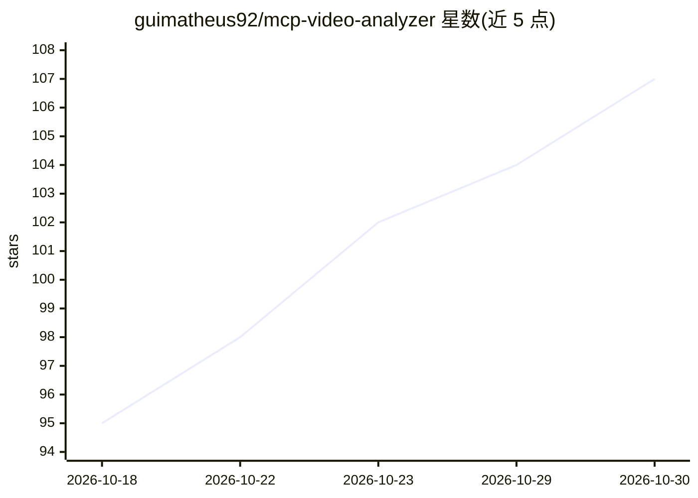

# guimatheus92/mcp-video-analyzer

⭐ 107 · TypeScript · MIT · 推送 2026-10-25 · [GitHub](https://github.com/guimatheus92/mcp-video-analyzer) · [官网](https://glama.ai/mcp/servers/guimatheus92/mcp-video-analyzer) · 个人维护

**把视频转成转录、关键帧、OCR 与元数据的 MCP 服务器**

面向 AI agent 的视频分析 MCP 服务器：将 YouTube、Instagram、TikTok、Loom、X、Vimeo、直链 URL 与本地文件转为带时间戳的转录（原生字幕或 Whisper 兜底）、场景切换关键帧、Tesseract OCR 文本、合并时间线与元数据/评论/章节。提供 8 个粒度不同的工具（整体分析、批量、仅转录、仅帧、时间段深挖等）。以 npx 运行，另有 CLI 单次模式与 Agent Skills 安装；平台 URL 依赖 yt-dlp，帧提取可由内置 ffmpeg-static 完成。

## 筛选速览

| 维度 | 判定 | 备注 |
|---|---|---|
| AI 角色 | `ai-ecosystem` | LLM/agent 周边工具 |
| 许可风险 | `permissive` | MIT |
| 部署形态 | `desktop` | 安装包/桌面程序 |
| 模型依赖 | — | README 未给出锁定关系 |
| 硬件要求 | — | 无带数字的原话,不猜 |
| 安装摩擦 | `medium` | 含编译或系统依赖之一 |
| 成熟度 | — | 结构信号不足 |

## 能力要点

- 转录+关键帧+OCR+时间线合并输出，覆盖 yt-dlp 支持的平台、直链与本地文件
- 8 个工具按需调用：全量分析、批量可续跑、仅转录/元数据/帧、时间段深挖与帧连拍
- 无原生字幕时回退 Whisper 转录，OCR 默认 Tesseract eng+por
- 提供 Claude Code 插件、MCP 配置、npx skills 与独立 CLI 四种接入方式

## 适用场景

- 让 Claude/Cursor/Copilot 等 agent 直接分析视频链接或本地录像
- 批量转录并 OCR 整个文件夹的视频，结果持久化可续跑
- 深挖视频某一时间段：帧连拍+过滤转录+OCR

## 场景标签

`语音识别` `OCR` · 领域:感知与多模态

## 证据(README 行号)

> L12:  mcp-video-analyzer MCP server
> L28: There are three ways in: the **`/video` plugin** (Claude Code — slash command + MCP server auto-configured), a plai
> L127: Eight tools — the AI picks the cheapest one for the job and calls it automatically. Click any tool to expand its p

## 星数曲线

2026-10-18 95 → 2026-10-30 107（+12）

---
*卡片 v1 · prompt 1.4 · 生成 2026-10-23 · 置信度 mid · 依据 README sha `d72ab4abbe38` · [字段定义](../../DATASET.md)*
