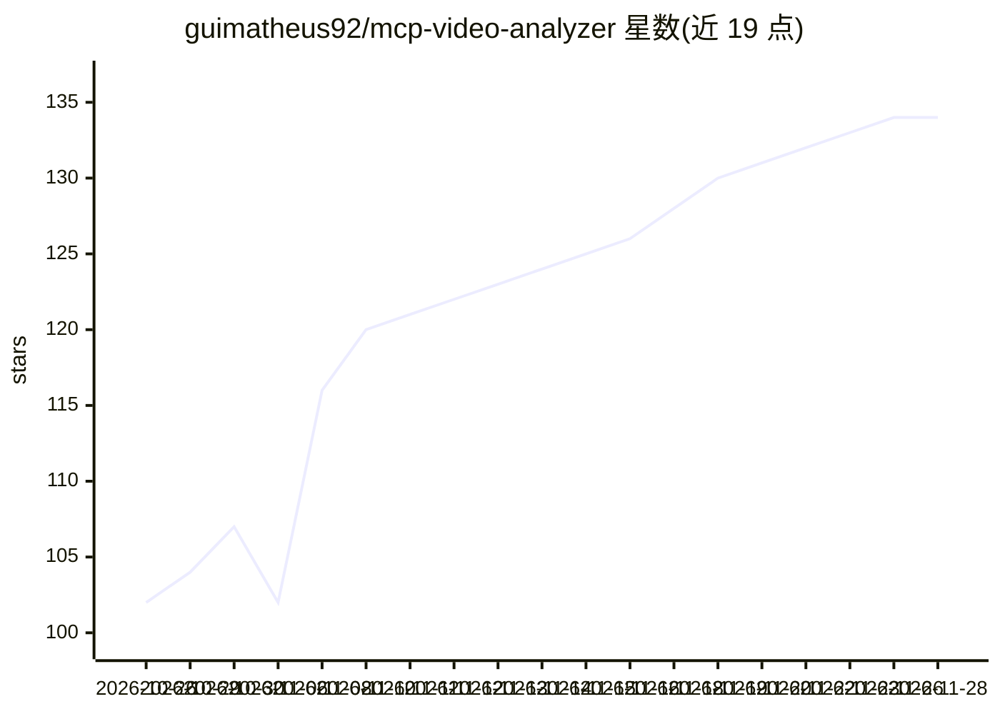

# guimatheus92/mcp-video-analyzer

⭐ 134 · TypeScript · MIT · 推送 2026-11-23 · [GitHub](https://github.com/guimatheus92/mcp-video-analyzer) · [官网](https://glama.ai/mcp/servers/guimatheus92/mcp-video-analyzer) · 个人维护

**MCP 视频分析服务器：为 AI agent 提供转录、关键帧、OCR 与元数据**

以 MCP server 与独立 CLI 两种形式运行的视频分析工具，支持 YouTube、Instagram、TikTok、Loom、X、Vimeo、Bilibili 等平台链接、直链与本地文件。提供 8 个工具，输出转录（原生字幕或 Whisper 回退）、场景变化检测的关键帧、Tesseract OCR 文本、注释时间线、元数据、评论与章节。依赖 Node.js 22.12+，平台 URL 下载依赖 yt-dlp，帧提取由打包的 ffmpeg-static 完成；无 yt-dlp/Chrome 时直链与本地文件仍可提取帧。结果内存缓存 10 分钟，支持 sidecar 持久化续跑。

## 筛选速览

| 维度 | 判定 | 备注 |
|---|---|---|
| AI 角色 | `ai-ecosystem` | LLM/agent 周边工具 |
| 许可风险 | `permissive` | MIT |
| 部署形态 | `desktop` | 安装包/桌面程序 |
| 模型依赖 | — | README 未给出锁定关系 |
| 硬件要求 | — | 无带数字的原话,不猜 |
| 安装摩擦 | `medium` | 含编译或系统依赖之一 |
| 成熟度 | — | 结构信号不足 |

## 能力要点

- 8 个 MCP 工具：全量分析、批量处理、转录、元数据、关键帧、时间段深挖等
- 转录支持原生字幕与 Whisper 回退，OCR 默认 eng+por 语言
- 场景变化检测 + 密集采样的关键帧提取，1-60 帧自适应
- brief/standard/detailed 三档分析深度，10 分钟内存缓存与可续跑 sidecar

## 适用场景

- 让 AI 助手分析视频链接并回答内容问题
- 批量转录与归档本地视频文件
- 提取屏幕上的文字、错误信息与 UI 文本（OCR）
- 定位视频中特定时刻的画面与对话

## 场景标签

`语音识别` `OCR` · 领域:感知与多模态

## 证据(README 行号)

> L5:  Turn any video — YouTube, Instagram, TikTok, Loom, X, Vimeo, direct links, local files — into transcripts, key fram
> L12:  mcp-video-analyzer MCP server
> L28: There are three ways in: the **`/video` plugin** (Claude Code — slash command + MCP server auto-configured), a plai

## 星数曲线

2026-10-26 102 → 2026-11-28 134（+32）

---
*卡片 v1 · prompt 1.4 · 生成 2026-11-28 · 置信度 mid · 依据 README sha `17815af247a5` · [字段定义](../../DATASET.md)*
