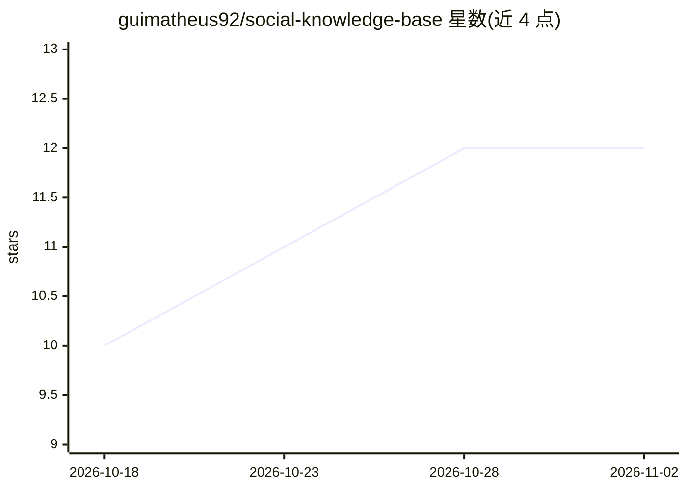

# guimatheus92/social-knowledge-base

⭐ 12 · TypeScript · MIT · 推送 2026-06-29 · [GitHub](https://github.com/guimatheus92/social-knowledge-base) · 个人维护

**把创作者短视频转成可检索知识库的自托管应用（下载+转录+RAG）**

面向个人用户的自托管工具：用 gallery-dl（配合 yt-dlp、ffmpeg、浏览器 cookies）批量下载 Instagram 公开账号的视频（含 Highlights），再用 faster-whisper medium 在 GPU（或回退 CPU）上批量转录生成 .vtt 副产物，最后由 Claude Code 等 LLM 结合帧与 OCR 为每个视频写 markdown 笔记，并生成主题 OVERVIEW 与可查询的 RAG 索引（query.py，含笔记引用）。提供 Next.js 16 网页应用（PT/EN 双语）与 Docker Compose 部署。目前支持 Instagram，TikTok/YouTube 支持开发中；需自备一次性账号的 cookies.txt 凭据。

## 筛选速览

| 维度 | 判定 | 备注 |
|---|---|---|
| AI 角色 | `ai-native` | 本体是模型或模型工具 |
| 许可风险 | `permissive` | MIT |
| 部署形态 | `desktop` | 安装包/桌面程序 |
| 模型依赖 | — | README 未给出锁定关系 |
| 硬件要求 | — | 无带数字的原话,不猜 |
| 安装摩擦 | `low` | 无编译、无系统依赖或容器化 |
| 成熟度 | — | 结构信号不足 |

## 能力要点

- gallery-dl 批量下载整账号视频（含 Highlights），SQLite manifest 支持断点续跑
- faster-whisper GPU 批量转录（CUDA，约 16–24× 实时），无 GPU 回退 CPU
- LLM 经 MCP 读取转录+帧+OCR，逐视频生成 markdown 笔记，笔记语言可配
- transcript/notes 建索引，query.py 提供 RAG 查询并带笔记引用

## 适用场景

- 把关注的创作者全部短视频沉淀成可检索的 markdown 知识库
- 批量下载并转录某 Instagram 账号的 Reels/Highlights
- 对笔记做主题式汇总与带引用的 RAG 问答

## 场景标签

`知识库管理` `RAG` `语音识别` · 领域:知识与检索

## 证据(README 行号)

> L6: Turns a creator's videos (Instagram today; **TikTok/YouTube in progress**) into a markdown knowledge base: an LLM **
> L34: 2. **Transcription (GPU)** — `scripts/transcribe_gpu.py` transcribes in bulk with faster-whisper `medium` on CUDA (
> L35: 3. **Notes** — Claude Code (any capable LLM; Claude Opus recommended), via `prompts/build-notes.md`, processes **on

## 星数曲线

2026-10-18 10 → 2026-11-02 12（+2）

---
*卡片 v1 · prompt 1.4 · 生成 2026-11-01 · 置信度 high · 依据 README sha `daf158a41061` · [字段定义](../../DATASET.md)*
