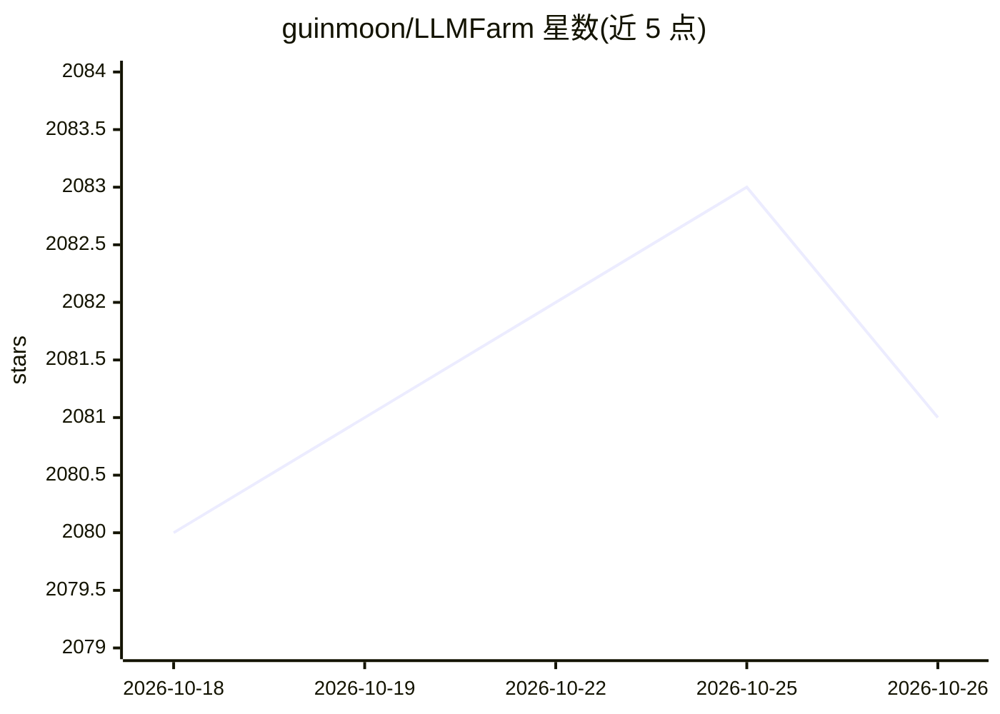

# guinmoon/LLMFarm

⭐ 2,081 · C · MIT · 推送 2026-01-30 · [GitHub](https://github.com/guinmoon/LLMFarm) · [官网](https://llmfarm.space) · 个人维护

**在 iOS/macOS 上离线加载运行各类本地 LLM 的应用**

基于 ggml 与 llama.cpp 的 iOS/macOS 应用，支持加载 LLaMA、Gemma、Qwen、DeepSeek、Mixtral、Mamba、RWKV 等多种推理后端及 LLaVA、Moondream 等多模态模型，可设置参数、切换采样方法、使用模板、恢复上下文、通过 Apple Shortcuts 调用并支持 RAG。用户可在本地测试不同 LLM 在 iOS/macOS 上的表现以挑选合适模型。应用暂不可从 TestFlight 与 App Store 获取；构建需递归克隆仓库（llmfarm_core 在独立仓库）。Metal 加速在 Intel Mac 上不可用。

## 筛选速览

| 维度 | 判定 | 备注 |
|---|---|---|
| AI 角色 | `ai-native` | 本体是模型或模型工具 |
| 许可风险 | `permissive` | MIT |
| 部署形态 | `None` |  |
| 模型依赖 | — | README 未给出锁定关系 |
| 硬件要求 | — | 无带数字的原话,不猜 |
| 安装摩擦 | `low` | 无编译、无系统依赖或容器化 |
| 成熟度 | `idea` | |

## 能力要点

- 支持 17+ 种推理后端与多种多模态模型（LLaVA/Moondream 等）
- 多种采样方法（temp/top-k/top-p、TFS、Mirostat、Grammar 等）
- Apple Shortcuts 集成与 RAG 支持
- 模型设置模板与上下文状态恢复

## 适用场景

- 在 iPhone 或 Mac 上离线运行和对话本地 LLM
- 对比不同模型在本机上的性能表现
- 通过快捷指令将本地模型接入系统自动化

## 场景标签

`推理引擎` `聊天机器人` `多模态` · 领域:对话与助手

## 证据(README 行号)

> L14: LLMFarm is an iOS and MacOS app to work with large language models (LLM). It allows you to load different LLMs with
> L15: Based on ggml and llama.cpp by Georgi Gerganov.

## 星数曲线

2026-10-18 2,080 → 2026-10-26 2,081（+1）

---
*卡片 v1 · prompt 1.4 · 生成 2026-10-21 · 置信度 high · 依据 README sha `74865ed15c48` · [字段定义](../../DATASET.md)*
