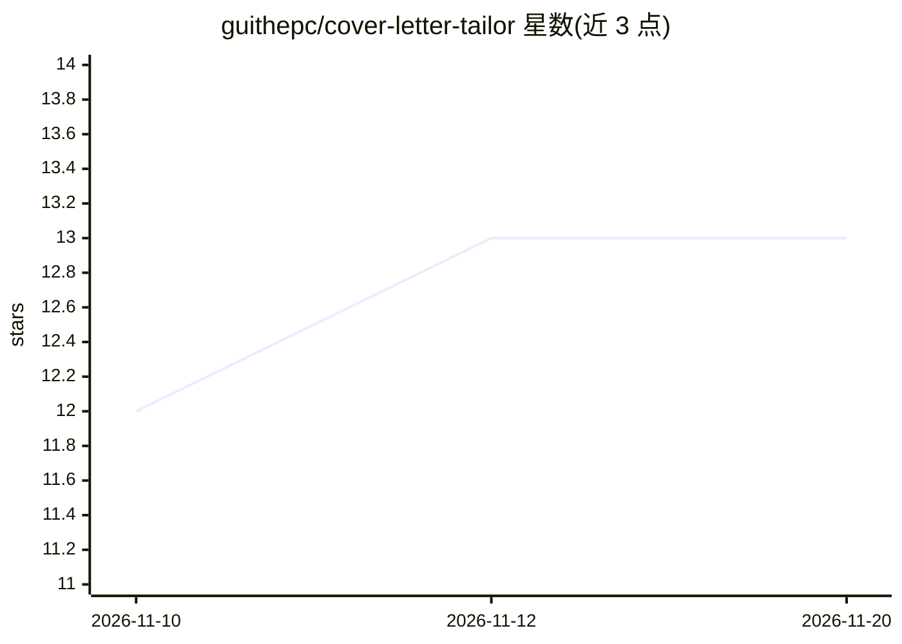

# guithepc/cover-letter-tailor

⭐ 13 · 推送 2026-05-19 · [GitHub](https://github.com/guithepc/cover-letter-tailor) · 个人维护

**从 CV 和职位描述生成定制求职信的 Claude skill**

以 Claude skill 形式提供的求职信生成工具：读取 .tex 或纯文本格式的 CV，从 URL 抓取职位信息（无法访问时要求用户粘贴），可选择输出语言（英语或葡萄牙语），生成 250-380 词、将真实经历与职位要求关联的求职信。约定避免空泛套话，且输出中不使用破折号。通过 npx skills 命令安装，在聊天中粘贴 CV 与职位 URL 即可使用。

## 筛选速览

| 维度 | 判定 | 备注 |
|---|---|---|
| AI 角色 | `ai-native` | 本体是模型或模型工具 |
| 许可风险 | `none` | — |
| 部署形态 | `library` | 以包/库形式分发 |
| 模型依赖 | locked-api |  |
| 硬件要求 | — | 无带数字的原话,不猜 |
| 安装摩擦 | `low` | 无编译、无系统依赖或容器化 |
| 成熟度 | — | 结构信号不足 |

## 能力要点

- 读取 .tex 或纯文本 CV，从 URL 抓取职位描述
- 支持英语/葡萄牙语输出，250-380 词定长
- 按具体职位与公司定制，避免通用模板套话

## 适用场景

- 针对具体职位投递时生成贴合岗位要求的求职信
- 希望基于真实 CV 经历而非模板写求职信
- 需要英语或葡萄牙语版本的求职信

## 场景标签

`AI 写作` · 领域:内容生成

## 证据(README 行号)

> L3: A Claude skill that writes personalized, tailored cover letters based on your CV and the job posting you want to app
> L10: - Writes a 250-380 word letter that connects your real experience to the job requirements

## 星数曲线

2026-11-10 12 → 2026-11-20 13（+1）

---
*卡片 v1 · prompt 1.4 · 生成 2026-11-18 · 置信度 high · 依据 README sha `902e9701df7e` · [字段定义](../../DATASET.md)*
