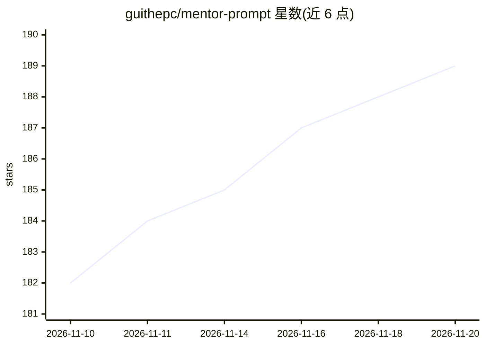

# guithepc/mentor-prompt

⭐ 189 · 推送 2026-08-16 · [GitHub](https://github.com/guithepc/mentor-prompt) · 个人维护

**把 Claude 变成技术导师的提示词文件，逼你自己思考**

一个葡萄牙语编写的提示词工程仓库：核心资产是 INSTRUCTION.md，用户把其内容粘贴到项目根目录的 CLAUDE.md 末尾，使 Claude Code 在日常工作中以导师而非代劳者的方式行事——用提问引导、指出思路偏离、要求先自行推理与试错再查资料。其中第 4 条规则需用户自行填写自己的薄弱点与舒适区（如测试、CSS、SQL），其余 9 条通用。适用于任何技术栈的学习场景。

## 筛选速览

| 维度 | 判定 | 备注 |
|---|---|---|
| AI 角色 | `ai-knowledge` | 知识聚合/清单类 |
| 许可风险 | `none` | — |
| 部署形态 | `None` |  |
| 模型依赖 | locked-api |  |
| 硬件要求 | — | 无带数字的原话,不猜 |
| 安装摩擦 | `low` | 无编译、无系统依赖或容器化 |
| 成熟度 | — | 结构信号不足 |

## 能力要点

- INSTRUCTION.md 提示词将 Claude 定位为提问式导师而非答案提供者
- 要求用户定制第 4 条：填写个人薄弱点与舒适区
- 通过 CLAUDE.md 末尾放置使导师指令成为模型最后读取的上下文

## 适用场景

- 在用 Claude Code 写项目时训练自己的设计与推理能力
- 避免直接复制 AI 答案导致学习不牢固
- 针对个人薄弱点（如测试/SQL/CSS）定制学习压力

## 场景标签

`提示工程` · 领域:Agent 开发

## 证据(README 行号)

> L3: Um prompt que transforma o Claude num mentor técnico de verdade — que puxa, cobra e desafia — em vez de um assistent
> L11: O fluxo dentro do seu `CLAUDE.md` fica assim:

## 星数曲线

2026-11-10 182 → 2026-11-20 189（+7）

---
*卡片 v1 · prompt 1.4 · 生成 2026-11-17 · 置信度 high · 依据 README sha `c1e34f35be9c` · [字段定义](../../DATASET.md)*
