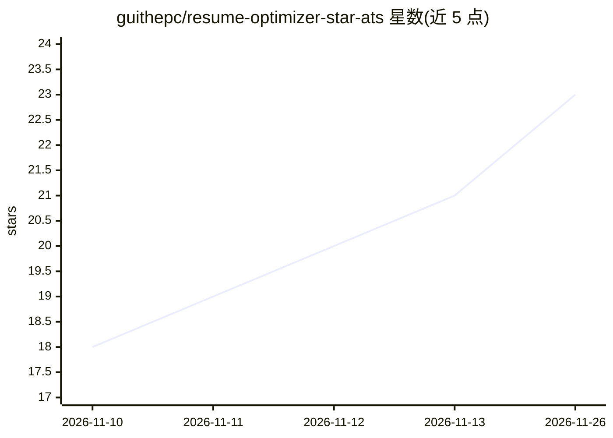

# guithepc/resume-optimizer-star-ats

⭐ 23 · 推送 2026-05-19 · [GitHub](https://github.com/guithepc/resume-optimizer-star-ats) · 个人维护

**改写简历要点的 Claude 技能：STAR/XYZ 框架加 ATS 关键词审计**

面向求职者的 Claude skill：将简历要点按 STAR 与 XYZ 框架改写为结果导向表述，优化 About/Summary 段落，并按技术岗位市场实际搜索的关键词做 ATS 审计。技能先识别用户领域（后端、前端、DevOps、数据、安全、移动端）再据此审计关键词；不虚构量化数据，先询问用户再协助量化；可输出带加粗关键词的 LaTeX (.tex) 格式简历。通过 npx skills 命令安装，使用时将简历内容粘贴到对话即可。

## 筛选速览

| 维度 | 判定 | 备注 |
|---|---|---|
| AI 角色 | `ai-native` | 本体是模型或模型工具 |
| 许可风险 | `none` | — |
| 部署形态 | `library` | 以包/库形式分发 |
| 模型依赖 | locked-api |  |
| 硬件要求 | — | 无带数字的原话,不猜 |
| 安装摩擦 | `low` | 无编译、无系统依赖或容器化 |
| 成熟度 | — | 结构信号不足 |

## 能力要点

- 按 STAR/XYZ 框架改写简历要点为结果导向表述
- 按 6 种技术领域做 ATS 关键词审计
- 不虚构量化指标，先询问用户再协助量化
- 输出带加粗关键词的 .tex LaTeX 简历格式

## 适用场景

- 求职前把薄弱的简历要点改写成有结果量的表述
- 检查简历是否命中技术岗位 ATS 关键词
- 优化简历 About/Summary 段落并导出 LaTeX 格式

## 场景标签

`AI 写作` · 领域:内容生成

## 证据(README 行号)

> L3: A Claude skill that rewrites your resume bullet points using the **STAR** and **XYZ** frameworks, optimizes your Abo
> L7: - Rewrites weak bullet points into results-driven statements using STAR and XYZ

## 星数曲线

2026-11-10 18 → 2026-11-26 23（+5）

---
*卡片 v1 · prompt 1.4 · 生成 2026-11-18 · 置信度 high · 依据 README sha `264ae62b8110` · [字段定义](../../DATASET.md)*
