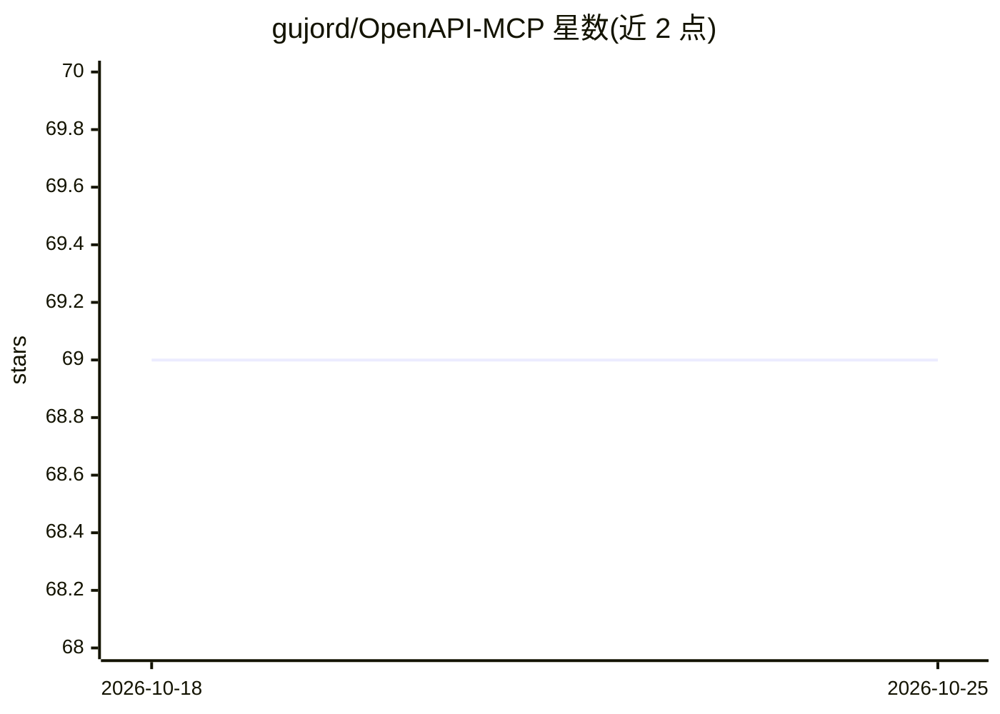

# gujord/OpenAPI-MCP

⭐ 69 · Python · MIT · 推送 2025-12-14 · [GitHub](https://github.com/gujord/OpenAPI-MCP) · [官网](https://github.com/gujord/OpenAPI-MCP) · 个人维护

**把 OpenAPI 规范动态转成 MCP 工具的代理服务器，供 AI agent 调外部 API**

基于 FastMCP 构建的 MCP 代理服务器：读取远程 URL 或本地 JSON/YAML 格式的 OpenAPI 规范，把其中的 API 操作注册为可调用的 MCP 工具，并把组件模式转为资源、按操作生成提示词，使 AI agent 无需自写 API 包装即可访问外部服务。支持 stdio、MCP HTTP（streamable）与 SSE（已标记弃用）三种传输，提供 OAuth2、用户名/密码及自定义请求头三类认证方式，通过环境变量配置，可同时运行多个 API 服务端。面向接入 Claude Desktop、Cursor、Windsurf 等 MCP 客户端的开发者。

## 筛选速览

| 维度 | 判定 | 备注 |
|---|---|---|
| AI 角色 | `ai-ecosystem` | LLM/agent 周边工具 |
| 许可风险 | `permissive` | MIT |
| 部署形态 | `self-host` | docker 或自建部署 |
| 模型依赖 | locked-api |  |
| 硬件要求 | — | 无带数字的原话,不猜 |
| 安装摩擦 | `low` | 无编译、无系统依赖或容器化 |
| 成熟度 | — | 结构信号不足 |

## 能力要点

- 将 OpenAPI 操作自动注册为 MCP 工具，名称/摘要/模式从规范自动派生
- 支持 stdio、MCP HTTP 流式传输与 SSE（SSE 已标记弃用）
- OAuth2 Client Credentials、用户名/密码与自定义认证头三种认证，带令牌缓存
- 支持加载本地 JSON/YAML 规范与多 API 服务并行运行

## 适用场景

- 让 Claude Desktop 等 MCP 客户端直接调用某个 REST API 而不用写包装代码
- 为需要 API key 或 OAuth2 的外部服务快速暴露 MCP 工具
- 同时代理多个 OpenAPI 服务并以工具名前缀区分

## 场景标签

`Agent 框架` · 领域:Agent 开发

## 证据(README 行号)

> L10: **The OpenAPI-MCP proxy translates OpenAPI specs into MCP tools, enabling AI agents to access external APIs without
> L16: The OpenAPI to Model Context Protocol (MCP) proxy server bridges the gap between AI agents and external APIs by **d
> L18: Built with **FastMCP** following official MCP patterns and best practices, the server provides:

## 星数曲线

2026-10-18 69 → 2026-10-25 69（+0）

---
*卡片 v1 · prompt 1.4 · 生成 2026-10-24 · 置信度 mid · 依据 README sha `4a655d727c25` · [字段定义](../../DATASET.md)*
