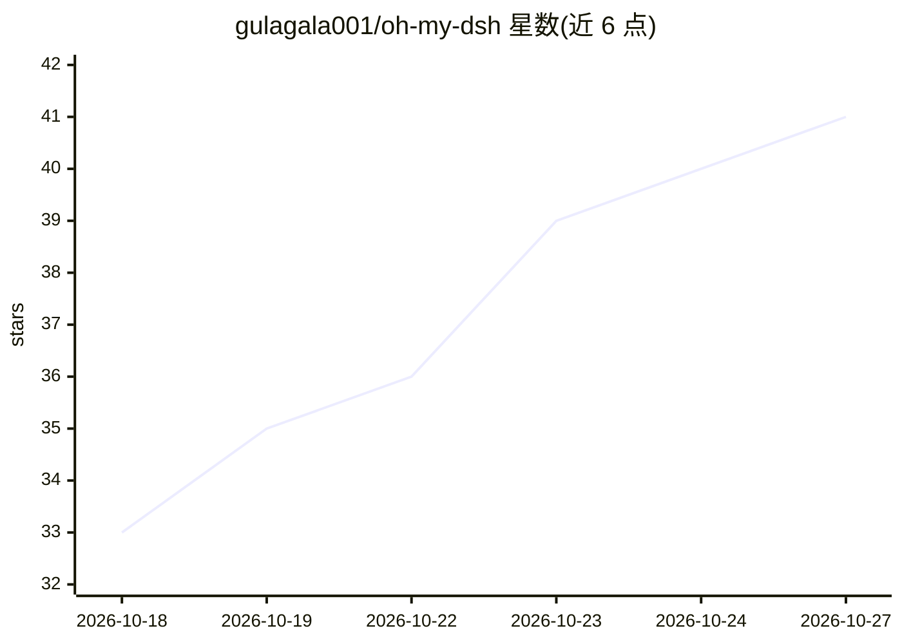

# gulagala001/oh-my-dsh

⭐ 41 · JavaScript · 推送 2026-10-26 · [GitHub](https://github.com/gulagala001/oh-my-dsh) · 个人维护 · 中文 README

**DeepSeek Harness 的插件包：长任务工作流、记忆与上下文管理**

面向 DSH（DeepSeek Harness）0.2.1-rc.3 的组合插件包，捆绑 Workflow 任务编排、Rewind 回退、Persona 人格、Extensions 技能/MCP/Hooks 管理、DeepSeek Workbench 网页工作台等组件，可整装也可选独立插件。机制上提供上下文优化与原文回查、AST/CodeGraph 代码定位、Dream 分层记忆、Ultra 三种协作方式，内置 OpenCU 2.2.0 浏览器与电脑操作，以及费用用量控制台。模型沿用 DSH 已有配置；完整内嵌浏览器等能力依赖匹配的宿主适配与系统权限，各独立插件的数据与版本分别管理。

## 筛选速览

| 维度 | 判定 | 备注 |
|---|---|---|
| AI 角色 | `ai-ecosystem` | LLM/agent 周边工具 |
| 许可风险 | `none` | — |
| 部署形态 | `None` |  |
| 模型依赖 | locked-api |  |
| 硬件要求 | — | 无带数字的原话,不猜 |
| 安装摩擦 | `low` | 无编译、无系统依赖或容器化 |
| 成熟度 | — | 结构信号不足 |

## 能力要点

- Ultra 提供 Workflow、Agent Team、自由三种协作方式
- 上下文优化、Auto Compact 与 Dream 分层（会话/项目/全局）记忆
- 内置 OpenCU 2.2.0 浏览器与应用观察操作
- 扩展页集中管理 Skill、MCP、指令文件、命令与 Hooks

## 适用场景

- 在 DSH 中执行需要续跑与回退的长任务工作流
- 长对话项目里保留背景记忆并回查原文
- 让模型经 OpenCU 操作浏览器与本地应用
- 统一管理插件、主题与订阅登录的用量费用

## 场景标签

`工作流自动化` `Agent 记忆` `浏览器自动化` `GUI 自动化` · 领域:Agent 开发

## 证据(README 行号)

> L3:  更顺手的 DSH 工作台，更连贯的长任务。 DeepSeek Harness 插件
> L46: OMD 组合 **Workflow、Rewind、Persona、Extensions 和 DeepSeek Workbench**，配合 OpenCU，以及主题插件及其 Glyph 外观。你可以使用 OMD 组合好的完整工作台，

## 星数曲线

2026-10-18 33 → 2026-10-27 41（+8）

---
*卡片 v1 · prompt 1.4 · 生成 2026-10-25 · 置信度 mid · 依据 README sha `389209e48c3c` · [字段定义](../../DATASET.md)*
