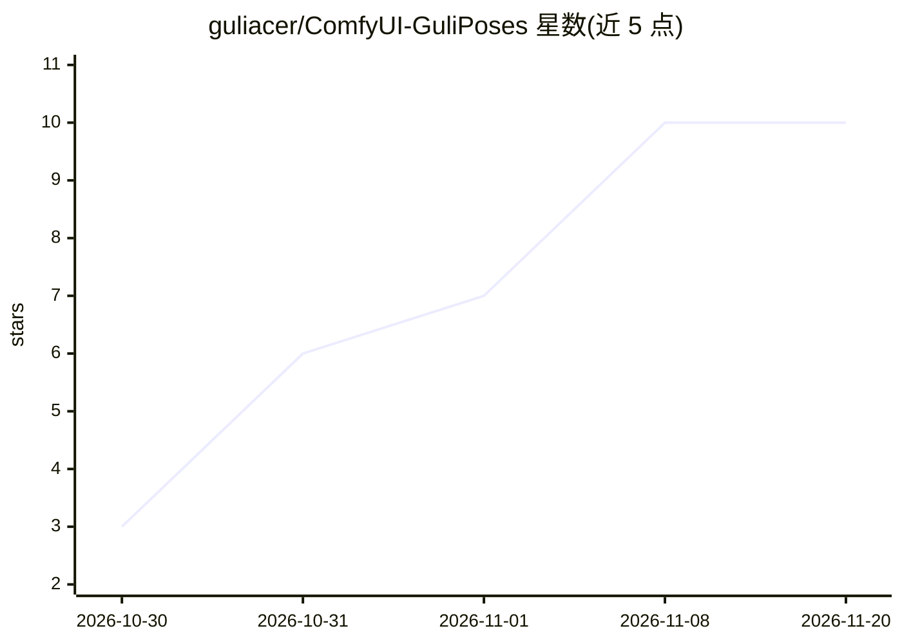

# guliacer/ComfyUI-GuliPoses

⭐ 10 · JavaScript · NOASSERTION · 推送 2026-10-30 · [GitHub](https://github.com/guliacer/ComfyUI-GuliPoses) · [官网](https://github.com/guliacer/ComfyUI-GuliNodes) · 个人维护 · 中文 README

**给 ComfyUI 用户的白模姿态参考图库节点，画廊内选图即输出**

以 ComfyUI 自定义节点形式提供的参考图库插件，包含三个节点：姿态库（288 组 × 5 视角，1439 张）、服装库（1405 套）、脸模库（44 张），在节点内置自绘画廊中翻选或随机抽取，输出一张 IMAGE 供下游接 ControlNet / Depth / Lineart / IP-Adapter 使用。支持固定选中、全库随机、范围内随机三种取图模式，支持导入自己的图、收件箱批量入库、用户素材独立存放与迁移脚本。仅使用 ComfyUI 自带的 PIL / numpy / torch，参数与分类全中文。图库含成人向内容，仅供艺术创作与技术学习。

## 筛选速览

| 维度 | 判定 | 备注 |
|---|---|---|
| AI 角色 | `ai-knowledge` | 知识聚合/清单类 |
| 许可风险 | `none` | NOASSERTION |
| 部署形态 | `None` |  |
| 模型依赖 | — | README 未给出锁定关系 |
| 硬件要求 | — | 无带数字的原话,不猜 |
| 安装摩擦 | `low` | 无编译、无系统依赖或容器化 |
| 成熟度 | — | 结构信号不足 |

## 能力要点

- 三个图库节点：姿态 1439 张 / 服装 1405 套 / 脸模 44 张，画廊内点选即输出
- 三种取图模式：固定选中、全库随机、范围内随机（系列×分类交集）
- 支持按钮 / 拖拽 / Ctrl+V 导入与收件箱整包入库，用户素材独立目录升级不丢
- 零额外依赖，只用 ComfyUI 自带的 PIL / numpy / torch

## 适用场景

- 在 ComfyUI 工作流里选一张姿态参考图接 ControlNet
- 批量生成时随机换姿势，做系列题材图
- 导入自己的姿势 / 服装 / 脸型参考图统一管理

## 场景标签

`图像生成` · 领域:内容生成

## 证据(README 行号)

> L16: **在 ComfyUI 节点里翻参考图库，选好就出图。**
> L18: 姿态 288 组 × 5 视角、服装 1405 套、脸模 44 张，画廊里翻选即出图，输出直接接 ControlNet / Depth / Lineart / IP-Adapter。
> L32: |全中文 · 零依赖|参数、输出、分类、姿势名全中文；只用 ComfyUI 自带的 PIL / numpy / torch|

## 星数曲线

2026-10-30 3 → 2026-11-20 10（+7）

---
*卡片 v1 · prompt 1.4 · 生成 2026-11-19 · 置信度 mid · 依据 README sha `7a4ab7e49fd5` · [字段定义](../../DATASET.md)*
