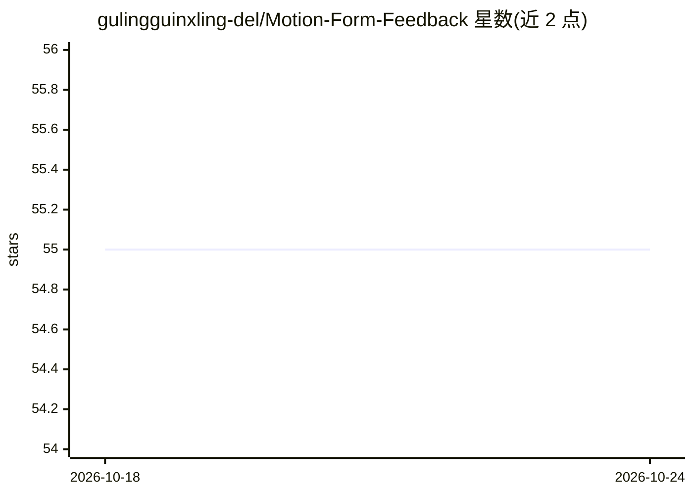

# gulingguinxling-del/Motion-Form-Feedback

⭐ 55 · HTML · 推送 2026-10-23 · [GitHub](https://github.com/gulingguinxling-del/Motion-Form-Feedback) · 组织维护

**用摄像头实时统计动作次数并纠正姿态的健身训练应用**

基于 OpenCV 与 MediaPipe 的本地健身分析应用：从摄像头帧提取 17 点骨架姿态，将每个动作窗口编码为 128 维动作指纹，经 LSTM 分类器判定为完整/半程/借力/无效动作四类，并在动作过程中给出实时语音与视觉纠正提示。支持 5 种动作，可通过 3 次标准动作示范自定义新动作。全程离线运行，数据存于本地 SQLite。声明为辅助分析工具而非医疗设备，实际精度受光照与拍摄角度影响。

## 筛选速览

| 维度 | 判定 | 备注 |
|---|---|---|
| AI 角色 | `ai-native` | 本体是模型或模型工具 |
| 许可风险 | `none` | — |
| 部署形态 | `None` |  |
| 模型依赖 | — | README 未给出锁定关系 |
| 硬件要求 | — | 无带数字的原话,不猜 |
| 安装摩擦 | `low` | 无编译、无系统依赖或容器化 |
| 成熟度 | — | 结构信号不足 |

## 能力要点

- 17 点骨架时间序列编码为 128 维动作指纹，LSTM 分类为四种动作类型
- 实时语音/视觉姿态纠正提示，基于个人 ROM 基线自适应校准
- 支持 5 种动作，可通过 3 次示范训练自定义新动作
- 全离线运行，数据存本地 SQLite，可导出 CSV/JSON

## 适用场景

- 在家训练时统计动作次数并获得实时姿态纠正
- 识别借力、半程等低质量动作并区分计数
- 训练后查看动作质量热图与疲劳指标等本地分析

## 场景标签

`目标检测` · 领域:感知与多模态

## 证据(README 行号)

> L58: Frame → Pose Landmarks (MediaPipe) → Movement Window Buffer (1.2s)
> L59: → Temporal Encoding → Intention Classifier → Rep Status + Voice Cue

## 星数曲线

2026-10-18 55 → 2026-10-24 55（+0）

---
*卡片 v1 · prompt 1.4 · 生成 2026-10-24 · 置信度 high · 依据 README sha `101d6169e14b` · [字段定义](../../DATASET.md)*
