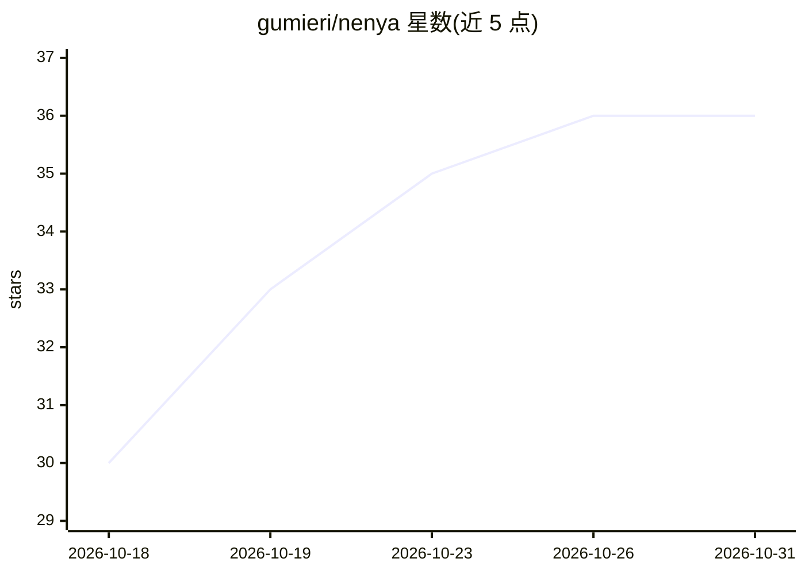

# gumieri/nenya

⭐ 36 · Go · Apache-2.0 · 推送 2026-10-27 · [GitHub](https://github.com/gumieri/nenya) · 个人维护

**Go 编写的零依赖 AI API 网关：密钥脱敏、多提供商路由与防注入**

面向本地 AI 编程客户端（OpenCode/Pi/Cursor 等）与上游 LLM 提供商之间的透明代理网关。核心机制：请求出站前的 Tier-0 正则密钥脱敏（AWS/GitHub 凭据等）、三层内容处理管道（熵过滤/TF-IDF 剪枝/引擎摘要）压缩上下文、23 个内置提供商适配器、带回退链与熔断的多提供商路由、SSE 流式透传，以及可选的防投毒栈（确定性提示注入检测、不可信内容聚光、出站管控、金丝雀陷阱线、MCP 参数守卫）。单个 Go 静态二进制、零运行时依赖，部署加固包括非 root 执行、mlock 密封、seccomp 与 systemd socket 激活。安装方式覆盖 Podman/Docker 容器、deb/rpm/pacman/Nix 原生包与 Helm。

## 筛选速览

| 维度 | 判定 | 备注 |
|---|---|---|
| AI 角色 | `ai-ecosystem` | LLM/agent 周边工具 |
| 许可风险 | `permissive` | Apache-2.0 |
| 部署形态 | `desktop` | 安装包/桌面程序 |
| 模型依赖 | — | README 未给出锁定关系 |
| 硬件要求 | — | 无带数字的原话,不猜 |
| 安装摩擦 | `low` | 无编译、无系统依赖或容器化 |
| 成熟度 | — | 结构信号不足 |

## 能力要点

- 请求出站前正则脱敏 AWS/GitHub 凭据等密钥
- 23 个内置提供商适配器，OpenAI/Anthropic 兼容端点即插即用
- 可选防投播栈：提示注入检测、出站管控、金丝雀陷阱线、MCP 参数守卫
- 单静态二进制零依赖，含熔断回退、响应缓存与粘性会话路由

## 适用场景

- 在 AI 编程客户端与云端模型之间拦截源码中的密钥外发
- 多个 LLM 提供商间做故障回退与延迟感知路由
- 对 MCP 工具调用做参数校验与注入防护

## 场景标签

`模型网关` · 领域:Agent 开发

## 证据(README 行号)

> L7: AI coding clients transmit your source code, prompts, and credentials to cloud LLM providers on every request. Nenya
> L9: **Compatible with any provider that implements the OpenAI Or Anthropic Chat Completions API.** For 23 providers we s
> L178: |`POST /v1/chat/completions`|Bearer + RBAC|OpenAI-compatible chat with SSE streaming, agent fallback, MCP multi-tu

## 星数曲线

2026-10-18 30 → 2026-10-31 36（+6）

---
*卡片 v1 · prompt 1.4 · 生成 2026-10-25 · 置信度 high · 依据 README sha `1f9117045a05` · [字段定义](../../DATASET.md)*
