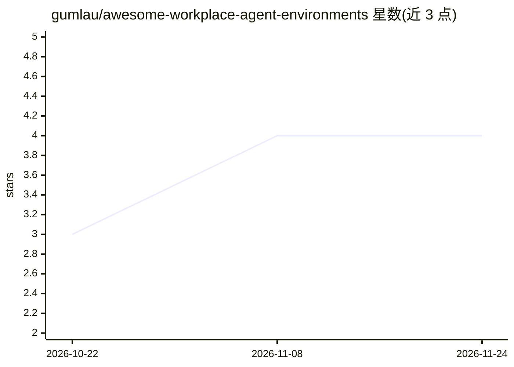

# gumlau/awesome-workplace-agent-environments

⭐ — · [GitHub]() · 个人维护 · 中文 README

**职场 AI Agent 环境/基准/数据集策展清单**

面向 Agent 后训练研究者策展的资源清单，收录职场邮件、聊天、日历、文档与企业应用场景的 20 个环境、15 个生成与训练资源、9 个数据集、5 个 provider 条目。条目摘录论文、仓库与数据卡，标注任务覆盖、数据来源、评估方法、状态后端与发布条款；声明所引结果来自原作者、未复现，跨基准指标不可直接比较。提供按研究需求查找起点的 Quick start 表。

## 筛选速览

| 维度 | 判定 | 备注 |
|---|---|---|
| AI 角色 | `ai-knowledge` | 知识聚合/清单类 |
| 许可风险 | `none` | — |
| 部署形态 | `None` |  |
| 模型依赖 | — | README 未给出锁定关系 |
| 硬件要求 | — | 无带数字的原话,不猜 |
| 安装摩擦 | `low` | 无编译、无系统依赖或容器化 |
| 成熟度 | — | 结构信号不足 |

## 能力要点

- 按通信、企业应用、个人桌面、真实会话重建四类组织 20 个环境
- 每个条目标注规模、来源、评估方式与状态后端
- 声明所引结果来自原作者且未复现，不构成跨基准排名
- 覆盖环境生成、轨迹合成、训练框架等 15 个后训练资源

## 适用场景

- 为 Agent 后训练研究挑选合适的评测环境
- 查找含中文/飞书任务覆盖的职场 Agent 基准
- 了解各环境的状态重置与部署方式差异

## 场景标签

`精选清单` · 领域:学习与行业

## 证据(README 行号)

> L17: > A curated collection of environments, benchmarks, training methods, and datasets for workplace agents.
> L21: 📅 **Research snapshot: 2026-10-08.** The collection currently includes 20 environments, 15 generation and training 
> L27: The focus is workplace communication and collaboration, together with environments and data relevant to agent post-

## 星数曲线

2026-10-22 3 → 2026-11-24 4（+1）

---
*卡片 v1 · prompt 1.4 · 生成 2026-11-21 · 置信度 high · 依据 README sha `b74245f5ea35` · [字段定义](../../DATASET.md)*
