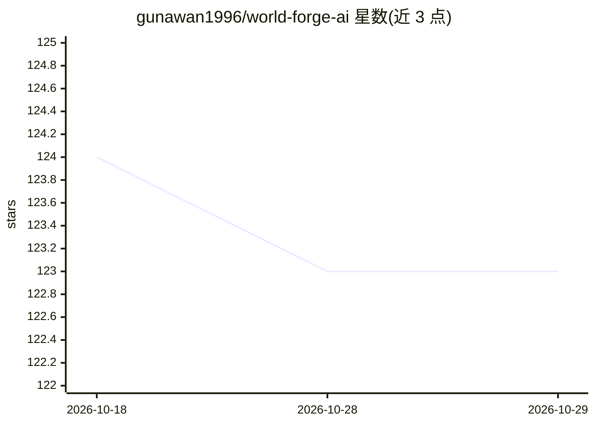

# gunawan1996/world-forge-ai

⭐ 123 · HTML · 推送 2026-10-28 · [GitHub](https://github.com/gunawan1996/world-forge-ai) · 个人维护

**从一句话生成自演化世界与叙事的 AI 叙事引擎**

面向小说作者、RPG 主持人、教育者与创意爱好者的 AI 叙事引擎：用户输入一句描述，系统生成地形图、气候、派系与隐藏设定；角色由世界逻辑自动生成，带有背景、目标与故事弧；剧情无固定脚本，随用户干预演化。底层由五个生成式 agent（制图师、编年史者、剧作家、声音、镜子）分层协作。支持 40+ 种语言输入、世界时间线分支与快照、RESTful API 与 WebSocket 流式输出，声明 MIT 许可。README 未给出具体的安装或运行方式，Download 小节为空标题，实际可获取形态不可验证。

## 筛选速览

| 维度 | 判定 | 备注 |
|---|---|---|
| AI 角色 | `ai-native` | 本体是模型或模型工具 |
| 许可风险 | `none` | — |
| 部署形态 | `None` |  |
| 模型依赖 | — | README 未给出锁定关系 |
| 硬件要求 | — | 无带数字的原话,不猜 |
| 安装摩擦 | `low` | 无编译、无系统依赖或容器化 |
| 成熟度 | — | 结构信号不足 |

## 能力要点

- 单句输入生成地图、气候、派系与隐藏设定
- 五个生成式 agent 分层协作的世界生成架构
- 支持 40+ 种语言输入与文化隐喻解读
- 世界时间线分支、快照与并行演化；提供 RESTful API 与 WebSocket

## 适用场景

- 小说作者生成世界与初稿素材并编辑打磨
- RPG 主持人快速生成区域、派系、传闻与任务钩子
- 教育场景演示叙事结构、地理与文化演化的因果关系

## 场景标签

`多智能体` `AI 写作` · 领域:Agent 开发

## 证据(README 行号)

> L13: NarrativeDust is an AI-driven narrative engine that transforms a single descriptive sentence into a fully realized,
> L63: NarrativeDust operates on a layered architecture of generative agents:

## 星数曲线

2026-10-18 124 → 2026-10-29 123（-1）

---
*卡片 v1 · prompt 1.4 · 生成 2026-10-23 · 置信度 low · 依据 README sha `42a58ce87265` · [字段定义](../../DATASET.md)*
