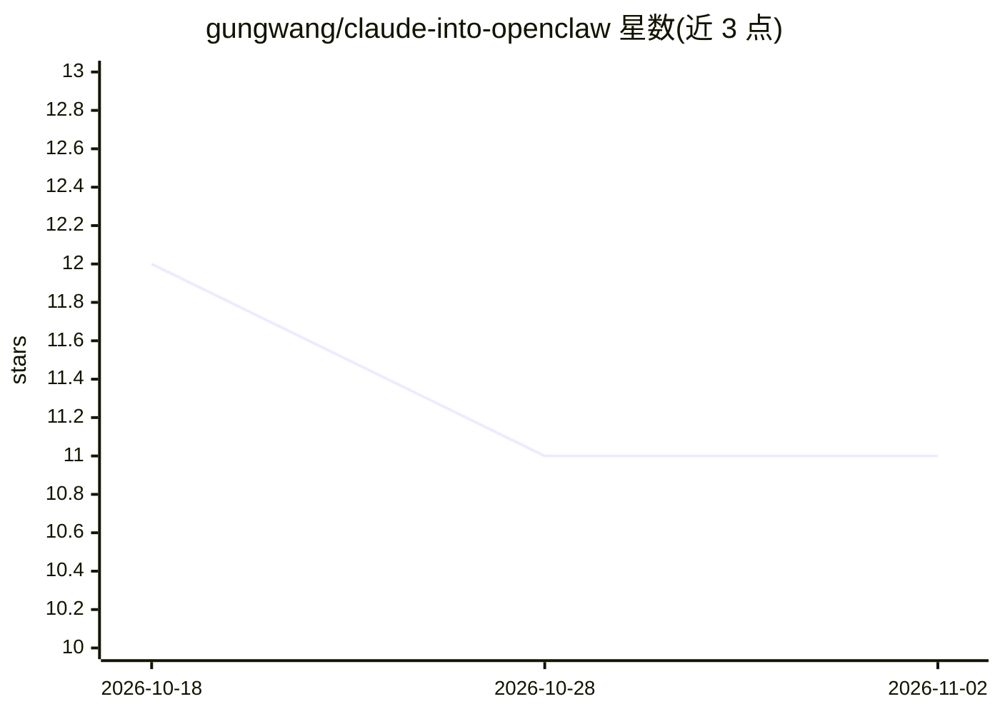

# gungwang/claude-into-openclaw

⭐ 11 · TypeScript · MIT · 推送 2026-05-01 · [GitHub](https://github.com/gungwang/claude-into-openclaw) · [官网](https://gungwang.com) · 个人维护 · 中文 README

**将 Claude Code 与 Hermes Agent 设计整合进 OpenClaw 的规范项目**

面向 OpenClaw 智能体平台的改进规范与分析仓库：分析 hermes-agent（Python AI agent 框架）与 claw-code（Claude-code 风格 harness 镜像）两个代码库，提出 7 条改进轨道（A–G），涵盖工具/命令规范身份层、路由可解释性、适配器成熟度分级（L0–L4）、策略决策可追溯、模式契约测试矩阵、技能审查与运行时信任标签。README 明确标注规范部分为‘仅计划/规范，不含实现改动’，另有从源码构建 OpenClaw 在 Ubuntu 22.04 上运行的记录（Node v22、pnpm、TypeScript 栈）。附中文 README 与中文规范。

## 筛选速览

| 维度 | 判定 | 备注 |
|---|---|---|
| AI 角色 | `ai-ecosystem` | LLM/agent 周边工具 |
| 许可风险 | `permissive` | MIT |
| 部署形态 | `None` |  |
| 模型依赖 | — | README 未给出锁定关系 |
| 硬件要求 | — | 无带数字的原话,不猜 |
| 安装摩擦 | `low` | 无编译、无系统依赖或容器化 |
| 成熟度 | `idea` | |

## 能力要点

- 分析 hermes-agent 与 claw-code 两个代码库并提取可落地的改进轨道
- 7 条改进轨道：身份层、路由可解释性、成熟度分级 L0–L4、策略可追溯等
- 提供规范、执行计划、技术参考、ADR、贡献者指南等多份文档
- 记录了从源码构建并本地运行 OpenClaw 的过程与构建栈

## 适用场景

- 为 OpenClaw 平台规划工具生态治理与适配器成熟度改进
- 参考 Claude Code / Hermes Agent 架构分析做 agent 平台演进设计
- 通过 PR 记录与文档了解整合工作的实施过程

## 场景标签

 · 领域:AI Agent 基础设施/规范

## 证据(README 行号)

> L30: Analyze the `hermes-agent` repository as an open-source AI coding agent framework and extract practical improvement
> L67: This repository serves as a bridge between Claude Code's architectural insights and OpenClaw's agent platform. By a
> L99: ## Objective

## 星数曲线

2026-10-18 12 → 2026-11-02 11（-1）

---
*卡片 v1 · prompt 1.4 · 生成 2026-11-02 · 置信度 high · 依据 README sha `3f970a6e7236` · [字段定义](../../DATASET.md)*
