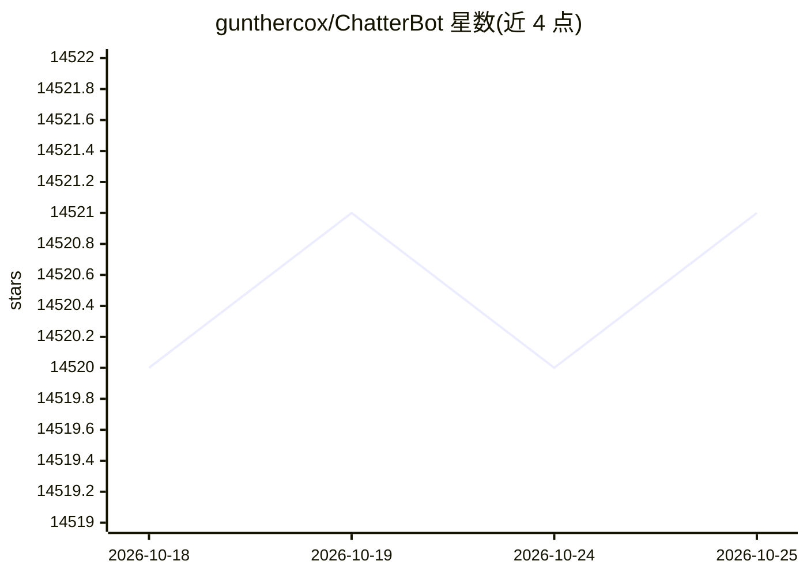

# gunthercox/ChatterBot

⭐ 14,521 · Python · BSD-3-Clause · 推送 2026-08-25 · [GitHub](https://github.com/gunthercox/ChatterBot) · [官网](http://docs.chatterbot.us/) · 个人维护

**面向开发者的 Python 机器学习对话引擎，用于创建聊天机器人**

基于机器学习的对话引擎 Python 库：从已知对话集合中生成回复，输入语句会被保存并与对应回复关联，随输入增多可回复的数量与准确度提升；通过搜索最匹配的已知语句、按回复出现频率选出最可能的回应。语言无关设计，可训练为任意语言，内置十余种语言的训练数据模块（chatterbot-corpus），社区欢迎提交语料。通过 PyPI 安装，BSD 3-clause 许可。

## 筛选速览

| 维度 | 判定 | 备注 |
|---|---|---|
| AI 角色 | `ai-native` | 本体是模型或模型工具 |
| 许可风险 | `permissive` | BSD-3-Clause |
| 部署形态 | `library` | 以包/库形式分发 |
| 模型依赖 | — | README 未给出锁定关系 |
| 硬件要求 | — | 无带数字的原话,不猜 |
| 安装摩擦 | `low` | 无编译、无系统依赖或容器化 |
| 成熟度 | — | 结构信号不足 |

## 动量与使用信号

- 维护:`active` — 距上次 push 53.9 天,年发版 7,87 位贡献者
- 涨星:近 1 天 **+0**(自 20261016 起算)
- 安装:pypi 包 `chatterbot` 月下载 3,498

## 能力要点

- 从已知对话集合生成匹配回复，随输入累积提升准确度
- 语言无关设计，可训练为任意语言
- 内置十余种语言的训练数据模块
- 提供 ChatterBotCorpusTrainer 训练接口

## 适用场景

- 为应用接入基于已知对话语料的自动回复机器人
- 用自有语料训练特定语言的对话机器人
- 向 chatterbot-corpus 贡献多语言训练数据

## 场景标签

 · 领域:对话系统/NLP

## 证据(README 行号)

> L5: ChatterBot is a machine-learning based conversational dialog engine built in
> L25: An untrained instance of ChatterBot starts off with no knowledge of how to communicate. Each time a user enters a s
> L81: ChatterBot is licensed under the BSD 3-clause license.

## 星数曲线

2026-10-18 14,520 → 2026-10-25 14,521（+1）

---
*卡片 v1 · prompt 1.4 · 生成 2026-10-18 · 置信度 high · 依据 README sha `0e3af236d0b8` · [字段定义](../../DATASET.md)*
