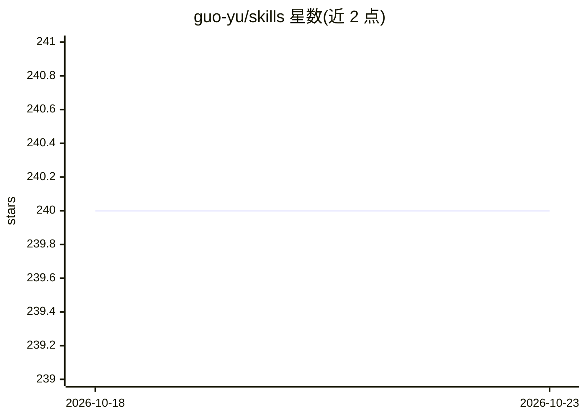

# guo-yu/skills

⭐ 240 · Shell · 推送 2026-01-23 · [GitHub](https://github.com/guo-yu/skills) · [官网](http://skill.guoyu.me/) · 个人维护 · 中文 README

**面向 Claude Code 的个人技能集：端口分配、技能开源、权限分析等**

个人维护的 Claude Code 自定义技能（skills）集合，含 6 个技能：port-allocator 为多个 Claude Code 实例分配开发端口避免冲突，share-skill 将本地技能迁移到 Git 仓库并支持开源，skill-permissions 分析技能权限并生成一次性授权命令，skill-i18n 将 SKILL.md 与 README 翻译成多语言，ceo-skill 提供项目仪表盘与 API 成本分析。可通过 Claude Code 插件市场或手动 git clone 加符号链接安装，以斜杠命令调用，附带 GitHub Pages 文档站点。

## 筛选速览

| 维度 | 判定 | 备注 |
|---|---|---|
| AI 角色 | `ai-ecosystem` | LLM/agent 周边工具 |
| 许可风险 | `none` | — |
| 部署形态 | `None` |  |
| 模型依赖 | — | README 未给出锁定关系 |
| 硬件要求 | — | 无带数字的原话,不猜 |
| 安装摩擦 | `low` | 无编译、无系统依赖或容器化 |
| 成熟度 | — | 结构信号不足 |

## 能力要点

- 6 个技能覆盖端口分配、技能开源迁移、权限分析、多语言翻译与项目仪表盘
- 支持 Claude Code 插件市场一键添加或手动 clone 加符号链接安装
- 内置由 share-skill 生成的在线文档站点（GitHub Pages / 自定义域名）

## 适用场景

- 在多个 Claude Code 实例并行开发时自动分配端口避免冲突
- 把本地积累的技能迁移到 Git 仓库并开源分享
- 分析技能权限并生成一次性授权命令

## 场景标签

 · 领域:开发者工具/AI 技能

## 证据(README 行号)

> L7: My collection of custom Claude Code skills for productivity and automation.
> L45: Use slash commands in Claude Code:

## 星数曲线

2026-10-18 240 → 2026-10-23 240（+0）

---
*卡片 v1 · prompt 1.4 · 生成 2026-10-22 · 置信度 high · 依据 README sha `8592a8c882a2` · [字段定义](../../DATASET.md)*
