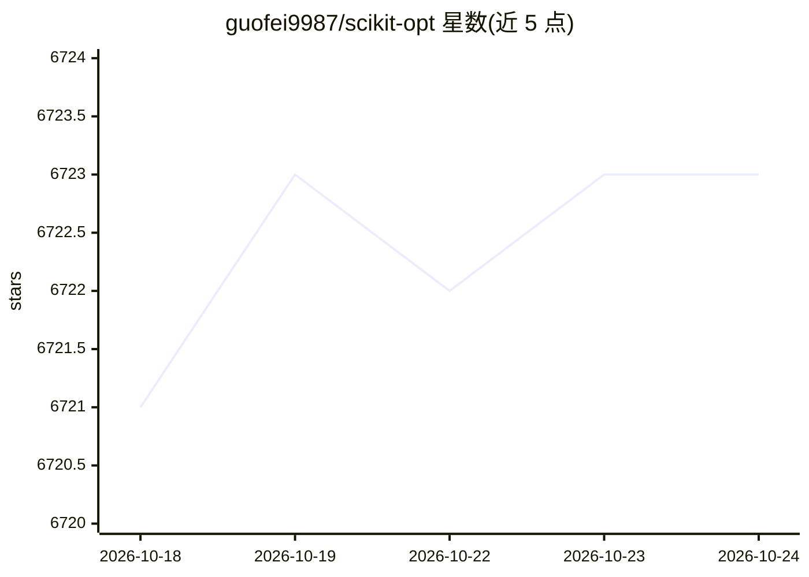

# guofei9987/scikit-opt

⭐ 6,723 · Python · MIT · 推送 2026-03-25 · [GitHub](https://github.com/guofei9987/scikit-opt) · [官网](https://scikit-opt.github.io/scikit-opt/#/en/) · 个人维护 · 中文 README

**Python 群体智能优化算法库：提供遗传算法、PSO、模拟退火等求解器**

以 Python 库形式提供的启发式优化算法集合，实现遗传算法（含 TSP 版本）、差分进化、粒子群优化、模拟退火（Fast/Boltzmann/Cauchy 三种）、蚁群算法、免疫算法和人工鱼群算法，用于函数优化与旅行商问题求解。支持用户自定义算子注册、断点续跑迭代、向量化/多线程/多进程/缓存四种加速方式，GPU 计算在开发中。通过 pip 安装，面向需要在代码中调用优化算法的开发者与科研用户。

## 筛选速览

| 维度 | 判定 | 备注 |
|---|---|---|
| AI 角色 | `ai-native` | 本体是模型或模型工具 |
| 许可风险 | `permissive` | MIT |
| 部署形态 | `library` | 以包/库形式分发 |
| 模型依赖 | — | README 未给出锁定关系 |
| 硬件要求 | — | 无带数字的原话,不猜 |
| 安装摩擦 | `low` | 无编译、无系统依赖或容器化 |
| 成熟度 | — | 结构信号不足 |

## 能力要点

- 7 类启发式算法：GA/DE/PSO/SA/ACA/IA/AFSA，含 TSP 专用版本
- 用户自定义算子（UDF）注册机制，内置十余个算子
- 支持迭代续跑与向量化/多线程/多进程/缓存四种加速
- PSO 支持多个非线性约束

## 适用场景

- 在 Python 中求解带约束的函数优化问题
- 用 GA 或 SA 求解旅行商问题并可视化结果
- 注册自定义交叉/变异/选择算子实现定制化遗传算法

## 场景标签

 · 领域:优化算法/科学计算

## 证据(README 行号)

> L14: Swarm Intelligence in Python
> L15: (Genetic Algorithm, Particle Swarm Optimization, Simulated Annealing, Ant Colony Algorithm, Immune Algorithm, Artif

## 星数曲线

2026-10-18 6,721 → 2026-10-24 6,723（+2）

---
*卡片 v1 · prompt 1.4 · 生成 2026-10-20 · 置信度 high · 依据 README sha `f495dc45b5db` · [字段定义](../../DATASET.md)*
