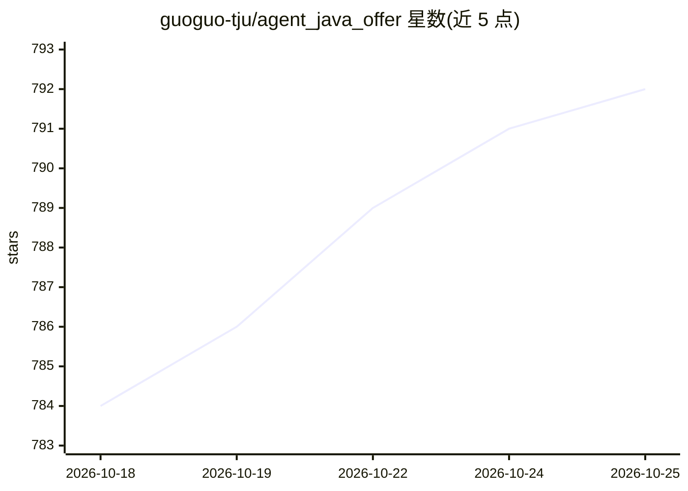

# guoguo-tju/agent_java_offer

⭐ 792 · NOASSERTION · 推送 2026-04-23 · [GitHub](https://github.com/guoguo-tju/agent_java_offer) · 个人维护 · 中文 README

**后端转 AI Agent 方向的面试结构化复习资料库**

一份面向从后端转型 AI Agent / 大模型应用工程的公开复习资料库，将分散笔记重组为可复习、口述与应对追问的结构化目录。内容分五大板块：AI（Agent、RAG、上下文工程、评测、安全、框架工程化等 9 个子题）、后端（MySQL/Redis/Kafka/JVM/Spring 等 11 个子题）、系统设计（8 个子题）、算法（按题型组织的 LeetCode 高频题）与项目表达（含匿名化项目口述场景）。提供三条推荐复习路线。README 声明内容持续整理中，文档采用 CC BY-NC 4. 许可。

## 筛选速览

| 维度 | 判定 | 备注 |
|---|---|---|
| AI 角色 | `ai-knowledge` | 知识聚合/清单类 |
| 许可风险 | `none` | NOASSERTION |
| 部署形态 | `None` |  |
| 模型依赖 | — | README 未给出锁定关系 |
| 硬件要求 | — | 无带数字的原话,不猜 |
| 安装摩擦 | `low` | 无编译、无系统依赖或容器化 |
| 成熟度 | — | 结构信号不足 |

## 能力要点

- 01_AI 覆盖 Agent、RAG、上下文工程、评测与安全等 9 个子题
- 后端板块含 MySQL/Redis/Kafka/JVM/Spring 等 11 个子题
- 三条推荐复习路线（转 AI Agent / 后端冲刺 / 项目口述强化）
- 文档内容默认采用 CC BY-NC 4.0 许可

## 适用场景

- 后端工程师准备 AI Agent / 大模型应用方向的技术面试
- 按题型系统复习后端、系统设计与算法高频题
- 准备项目口述与场景化追问的面试表达

## 场景标签

`教程课程` · 领域:学习与行业

## 证据(README 行号)

> L3: 一份面向 后端 转型到 AI Agent 的公开复习资料库。
> L30: 适合准备 Agent、RAG、上下文工程、skill、subagent、评测、安全、工程化相关面试。

## 星数曲线

2026-10-18 784 → 2026-10-25 792（+8）

---
*卡片 v1 · prompt 1.4 · 生成 2026-10-21 · 置信度 high · 依据 README sha `d9bd0aae169d` · [字段定义](../../DATASET.md)*
