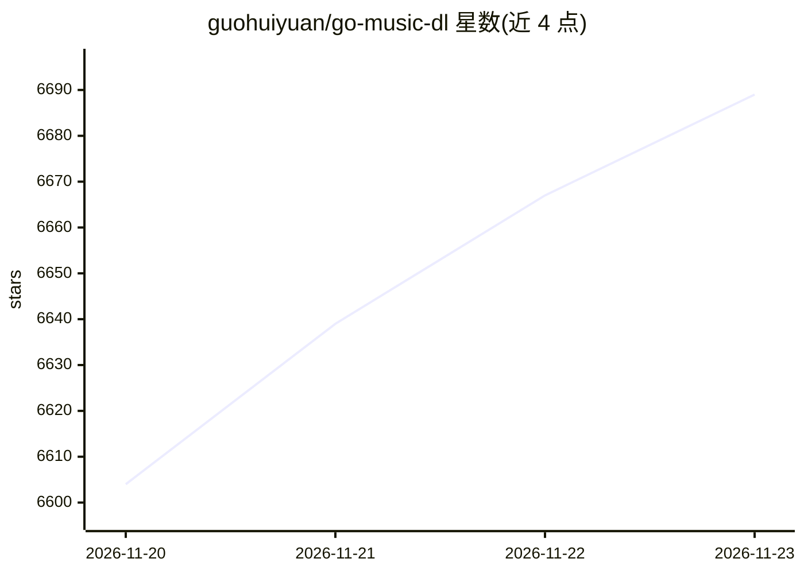

# guohuiyuan/go-music-dl

⭐ 6,689 · Go · AGPL-3.0 · 推送 2026-11-22 · [GitHub](https://github.com/guohuiyuan/go-music-dl) · [官网](https://music.zkkp.nyc.mn) · 个人维护 · 中文 README

**面向个人用户的多平台音乐搜索下载工具，支持 AI 接口操控播放器**

基于 Go 的多平台音乐聚合工具，提供 Web、TUI、桌面端与移动端形态，覆盖网易云、QQ、酷狗、酷我、咪咕、汽水、Apple Music、Spotify、Bilibili 等 10+ 平台的单曲、歌单、专辑与排行榜搜索下载，支持换源、Cookie/扫码登录、无损音质与本地音乐管理。AI 部分通过 HTTP 接口暴露搜索与播放器控制能力，AI 可直接点歌、切歌、调音量，多客户端按 client_id 隔离；接口默认无鉴权，README 提示勿暴露公网。

## 筛选速览

| 维度 | 判定 | 备注 |
|---|---|---|
| AI 角色 | `ai-enhanced` | 去掉 AI 部分产品仍成立 |
| 许可风险 | `viral` | AGPL-3.0 |
| 部署形态 | `desktop` | 安装包/桌面程序 |
| 模型依赖 | — | README 未给出锁定关系 |
| 硬件要求 | — | 无带数字的原话,不猜 |
| 安装摩擦 | `low` | 无编译、无系统依赖或容器化 |
| 成熟度 | — | 结构信号不足 |

## 能力要点

- Web/TUI/桌面/移动多端形态，覆盖单曲、歌单、专辑与排行榜
- AI 可通过 HTTP 接口远程操控已打开的网页播放器，SSE 回传真实播放状态
- 多源并发搜索、换源与无损音频解析，Cookie/扫码登录获取个人歌单
- 本地音乐扫描、元数据读取、SQLite 索引与 WebDAV 同步

## 适用场景

- 从多个音乐平台聚合搜索并批量下载歌曲或歌单
- 用 AI 助手通过对话点歌和控制网页播放器
- 扫描整理本地音乐库并补全封面歌词
- 解析音乐/歌单/专辑分享链接直接获取曲目

## 场景标签

 · 领域:音乐/媒体工具

## 证据(README 行号)

> L7: Go Music DL 是一个多平台音乐搜索与下载工具，支持 **Web**、**TUI** 和**桌面端**，覆盖单曲、歌单、专辑、排行榜与本地音乐。它同时暴露了一套 AI 可调用的接口——**AI 可以直接操控你正开着的网页播放
> L109: * **AI 操控网页**：AI 可通过 HTTP 接口直接控制已打开的网页播放器（点歌、切歌、暂停、音量、进度），多客户端各自独立，详见 AI 可以直接操控网页播放器。
> L164: * **AI 通道**：新增 AI 能力索引与播放器控制接口，AI 可直接点播并操控已打开的网页；多客户端按 `client_id` 隔离，命令定向投递、状态分槽存储，多标签页互不干扰。

## 星数曲线

2026-11-20 6,604 → 2026-11-23 6,689（+85）

---
*卡片 v1 · prompt 1.4 · 生成 2026-11-23 · 置信度 mid · 依据 README sha `a475eeea5172` · [字段定义](../../DATASET.md)*
