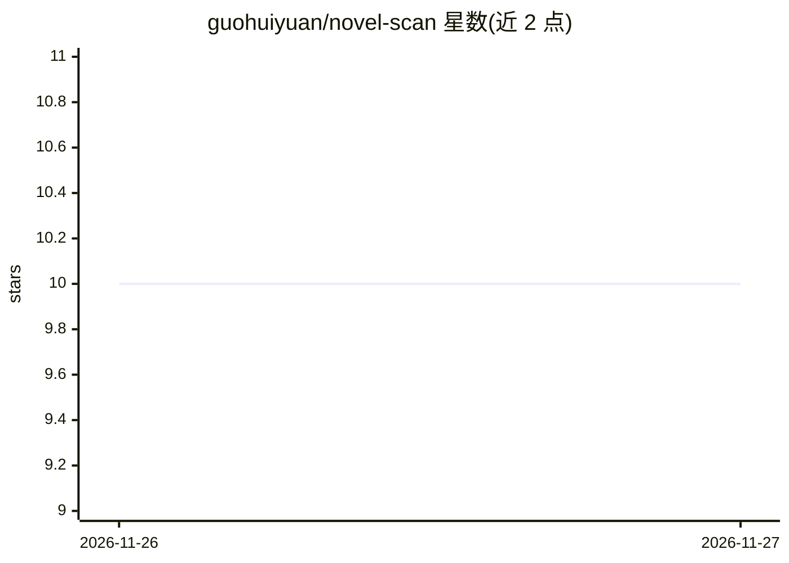

# guohuiyuan/novel-scan

⭐ 10 · Python · AGPL-3.0 · 推送 2026-11-20 · [GitHub](https://github.com/guohuiyuan/novel-scan) · 个人维护 · 中文 README

**把网文 .txt 生成可发布扫书稿的 Agent Skill**

以 Agent Skill 形式分发：输入一本 .txt 小说，先由纯正则脚本预扫切块并抽取人物线索，再由多个子代理并行读原文、逐人物汇总，最终产出扫书稿 Markdown、人物卡、结构化人物 JSON、按外貌反推的人物图与随机封面。核心理念是引文必须逐字来自原文、成品不含行号、证据不足的字段记为未知而非默认填写。安装方式为 git clone 到用户级 skill 目录，出图功能需另配 latent-media skill，仅扫读与封面无需 API key。

## 筛选速览

| 维度 | 判定 | 备注 |
|---|---|---|
| AI 角色 | `ai-native` | 本体是模型或模型工具 |
| 许可风险 | `viral` | AGPL-3.0 |
| 部署形态 | `None` |  |
| 模型依赖 | — | README 未给出锁定关系 |
| 硬件要求 | — | 无带数字的原话,不猜 |
| 安装摩擦 | `low` | 无编译、无系统依赖或容器化 |
| 成熟度 | — | 结构信号不足 |

## 能力要点

- 子代理并行直读原文，引文逐字可核验（自检 75/75 命中）
- 8 维评分 + 雷点/郁闷点分类体系（6 类雷点/26 类郁闷点）
- 按外貌反推 appearance_prompt 出图并保留 prompt/seed 溯源
- 输出结构化人物 JSON 供视频/知识库直接消费

## 适用场景

- 读完一本长篇网文后快速产出可发布的扫书帖
- 为扫书视频准备逐字台词素材与人物立绘
- 批量生成小说人物结构化数据入库

## 场景标签

`AI 写作` `图像生成` · 领域:内容生成

## 证据(README 行号)

> L5: 长篇网文扫书 Agent Skill —— 把一本 `.txt` 小说变成一套能直接发出去的扫书稿：
> L43: A0 脚本预扫（纯正则，秒级；切块 + 人物候选 + 外貌/雷点线索 + 重复收录检测）
> L64: git clone https://github.com/guohuiyuan/novel-scan.git ~/.workbuddy/skills/novel-scan

## 星数曲线

2026-11-26 10 → 2026-11-27 10（+0）

---
*卡片 v1 · prompt 1.4 · 生成 2026-11-26 · 置信度 high · 依据 README sha `d05260b053a3` · [字段定义](../../DATASET.md)*
