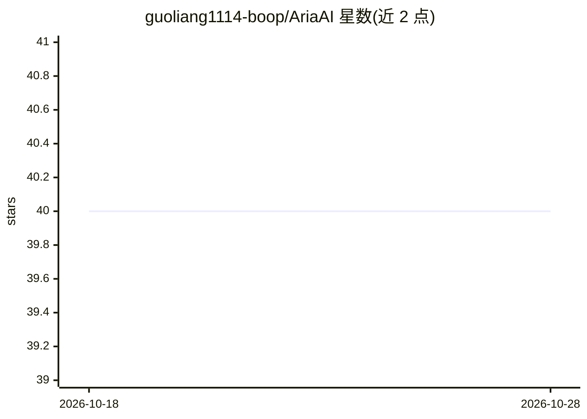

# guoliang1114-boop/AriaAI

⭐ 40 · Python · MIT · 推送 2026-10-16 · [GitHub](https://github.com/guoliang1114-boop/AriaAI) · [官网](https://aria.d2cgo.co/) · 个人维护 · 中文 README

**面向专业知识工作的开源 Agentic 工作区，含项目/客户记忆与技能工作流**

AriaAI 是开源的 AI-native 工作区，面向专业团队的知识工作：提供项目记忆、跨项目的客户记忆、带流式输出与工具调用的项目感知聊天、可复用 Skill 工作流、文档摄取与检索的知识工作流、高风险操作的人工审批（HITL）以及带检查点与回滚的运行 harness。技术栈为 React 19 + TypeScript 前端与 FastAPI + PostgreSQL 后端，需配置 LLM provider API key 运行实际 AI 请求，嵌入默认为离线 hash 基线。项目处于活跃开发期，部分文档描述的是近期设计方向而非已完成实现。

## 筛选速览

| 维度 | 判定 | 备注 |
|---|---|---|
| AI 角色 | `ai-native` | 本体是模型或模型工具 |
| 许可风险 | `permissive` | MIT |
| 部署形态 | `library` | 以包/库形式分发 |
| 模型依赖 | — | README 未给出锁定关系 |
| 硬件要求 | — | 无带数字的原话,不猜 |
| 安装摩擦 | `low` | 无编译、无系统依赖或容器化 |
| 成熟度 | `idea` | |

## 能力要点

- 项目记忆与长期客户记忆结构化管理
- 高风险写/删/改操作的人工审批与防篡改执行信封
- 带运行检查点、工具策略与回滚 diff 的原生 run harness
- Skill 工作流：有序包根、不可变内容指纹、增量刷新

## 适用场景

- 让 AI 长期沉淀项目与客户上下文支撑交付工作
- 在知识库上做带来源感知的 RAG 对话与文档工作流
- 对高风险 AI 操作引入审批、追踪与回滚路径

## 场景标签

`工作流自动化` `RAG` `Agent 记忆` · 领域:Agent 开发

## 证据(README 行号)

> L3: AriaAI is an open-source agentic workspace for professional knowledge work.
> L21: AriaAI is an open experiment in this direction: an AI-native workspace with memory, skills, knowledge retrieval, to
> L74: |`DEFAULT_LLM_PROVIDER` and provider API key|Configure a supported provider to run actual AI requests.|

## 星数曲线

2026-10-18 40 → 2026-10-28 40（+0）

---
*卡片 v1 · prompt 1.4 · 生成 2026-10-25 · 置信度 mid · 依据 README sha `fa05e2c0f965` · [字段定义](../../DATASET.md)*
