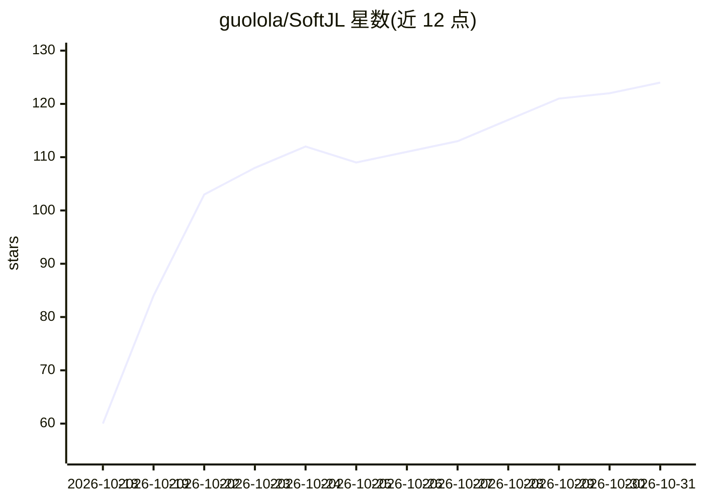

# guolola/SoftJL

⭐ 124 · TypeScript · Apache-2.0 · 推送 2026-10-29 · [GitHub](https://github.com/guolola/SoftJL) · [官网](https://jianglisoftware.com) · 组织维护 · 中文 README

**面向课程/毕设的自托管 AI 软件工程工作台，生成 UML、测试用例与文档**

SoftJL Community 是自托管的 AI 软件工程工作区，面向软件课程项目、毕业设计与 UML 作业：通过对话从系统描述生成 8 类 UML 模型、测试用例、覆盖矩阵与可编辑的 DOCX 工程文档（可行性报告、需求规格、设计说明），并以需求—设计—测试的溯源链接和变更影响跟踪贯穿全程。用户自带 OpenAI 兼容模型服务（BYOK），可选只读 MCP 供外部 Coding Agent 读取设计。技术栈为 React/Next.js、Fastify、PlantUML、Node.js 22，Apache-2.0 发布，需自行部署与构建；生成内容需人工审核，Coding Agent 实际客户端兼容性官方标注为待定。

## 筛选速览

| 维度 | 判定 | 备注 |
|---|---|---|
| AI 角色 | `ai-native` | 本体是模型或模型工具 |
| 许可风险 | `permissive` | Apache-2.0 |
| 部署形态 | `self-host` | docker 或自建部署 |
| 模型依赖 | — | README 未给出锁定关系 |
| 硬件要求 | — | 无带数字的原话,不猜 |
| 安装摩擦 | `low` | 无编译、无系统依赖或容器化 |
| 成熟度 | — | 结构信号不足 |

## 能力要点

- 从系统描述生成 UML 图、测试用例与可编辑 DOCX 工程文档
- 需求—设计—测试溯源链接、覆盖矩阵与变更影响跟踪
- BYOK：自带任意 OpenAI 兼容模型服务，含模型发现与连接测试
- 只读 MCP 接入外部 Coding Agent 读取设计与验收标准

## 适用场景

- 毕业设计/课程项目中从需求描述生成 UML 模型和测试用例
- 答辩前检查哪些需求缺少设计或测试支持，解释设计来源
- 需求变更后定位需要复查的设计与文档
- 配合外部 Coding Agent 用设计与验收标准指导编码

## 场景标签

`AI 写作` `代码生成` · 领域:编码与开发

## 证据(README 行号)

> L27: **Turn a system description into UML diagrams, test cases and editable Word specifications.** Follow requirement ch
> L33: SoftJL Community is a self-hosted AI software engineering workspace for capstone and course projects. Bring your ow
> L130: |🤖 Bring your own model service (BYOK)|✅|✅|OpenAI-compatible providers, model discovery and connection tests; usag

## 星数曲线

2026-10-18 60 → 2026-10-31 124（+64）

---
*卡片 v1 · prompt 1.4 · 生成 2026-10-23 · 置信度 high · 依据 README sha `8f28f3a3b00d` · [字段定义](../../DATASET.md)*
