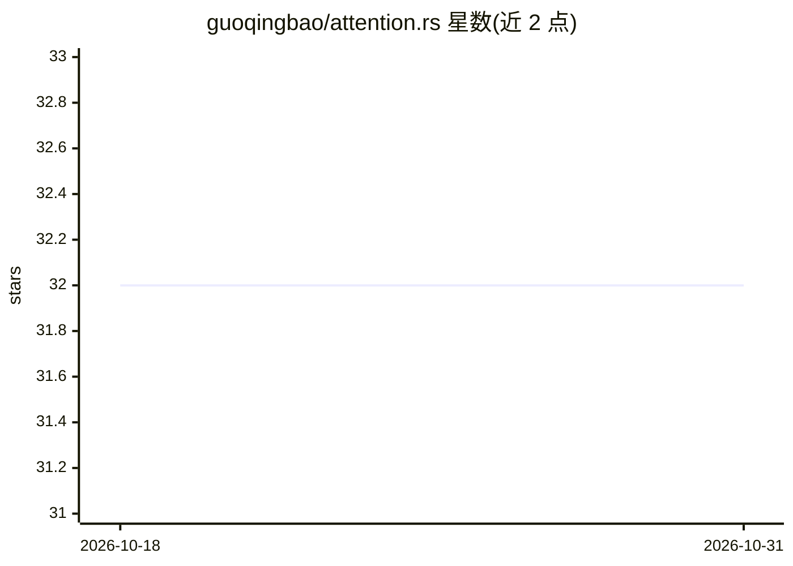

# guoqingbao/attention.rs

⭐ 32 · Cuda · 推送 2026-10-30 · [GitHub](https://github.com/guoqingbao/attention.rs) · 个人维护 · 中文 README

**Rust 的 LLM 注意力与算子 CUDA/Metal 内核库**

基于 Candle 构建的 Rust 内核库，为 LLM 推理引擎（xInfer/vLLM.rs、candle-vllm）提供基础算子：Flash-Attention-v2 风格内核（SM70 至 SM121，即 V100 到 Blackwell）、Paged Attention（CUDA 与 Apple Silicon Metal）、Chunked Prefill、融合 MoE 内核（标准与 FP8 权重、GGUF/ISQ）、融合 RoPE、GPU 采样，以及面向 Qwen 3.5 线性注意力的 Gated Delta Net/Mamba 内核。KV 缓存支持 BF16/FP8/Turbo 系列量化格式。通过 Cargo 依赖 git 仓库安装，按 feature 开关启用 CUDA、Metal、FlashInfer 等内核。MIT 许可。面向开发者。

## 筛选速览

| 维度 | 判定 | 备注 |
|---|---|---|
| AI 角色 | `ai-ecosystem` | LLM/agent 周边工具 |
| 许可风险 | `none` | — |
| 部署形态 | `None` |  |
| 模型依赖 | — | README 未给出锁定关系 |
| 硬件要求 | — | 无带数字的原话,不猜 |
| 安装摩擦 | `medium` | 含编译或系统依赖之一 |
| 成熟度 | — | 结构信号不足 |

## 能力要点

- Flash-Attention-v2 风格内核，覆盖 SM70–SM121（V100 到 Blackwell）
- Paged Attention 支持 CUDA 与 Apple Silicon Metal
- 融合 MoE 内核，支持标准与 FP8 量化权重及 GGUF/ISQ
- KV 缓存多格式量化（FP8、Turbo8/4/3，最高 4.7× 压缩）

## 适用场景

- 为 Rust LLM 推理引擎提供注意力与 MoE 算子
- 长序列推理中降低 KV 缓存内存占用
- 在 Apple Silicon 上运行带 Metal 内核的推理

## 场景标签

`推理引擎` · 领域:训练与推理

## 证据(README 行号)

> L3: > Efficient, cross-platform optimized kernels and operations for LLM inference in Rust, built on Candle.
> L7: `attention.rs` is a collection of high-performance CUDA and Metal kernels designed for Large Language Model (LLM) in

## 星数曲线

2026-10-18 32 → 2026-10-31 32（+0）

---
*卡片 v1 · prompt 1.4 · 生成 2026-10-26 · 置信度 high · 依据 README sha `7d140efe9d7c` · [字段定义](../../DATASET.md)*
