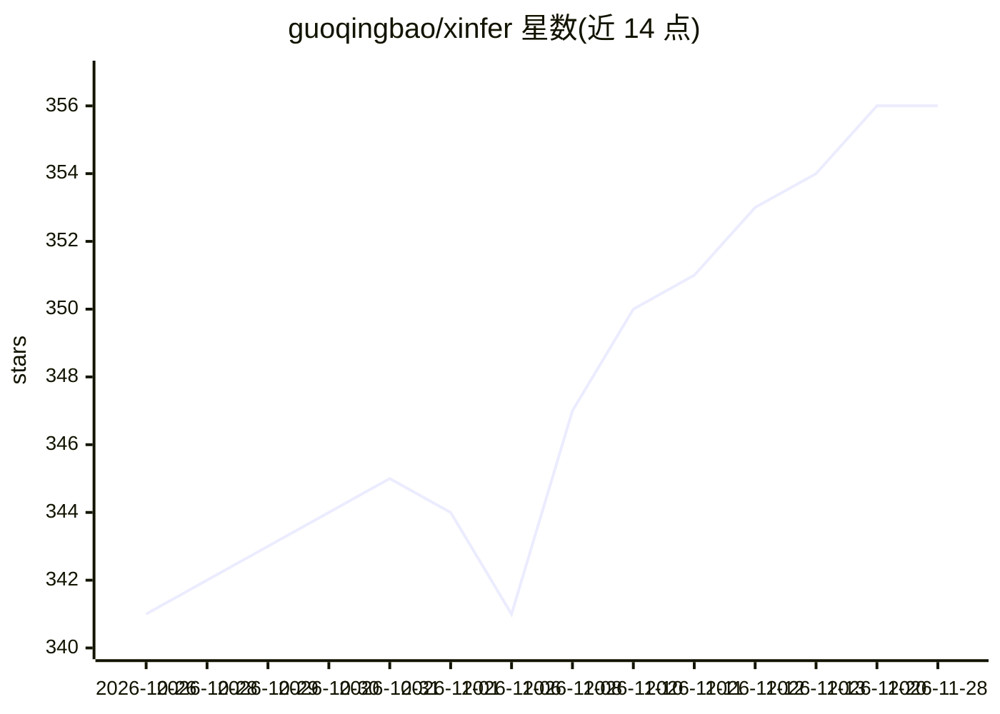

# guoqingbao/xinfer

⭐ 356 · Rust · MIT · 推送 2026-10-31 · [GitHub](https://github.com/guoqingbao/xinfer) · [官网](http://guoqingbao.github.io/xinfer/) · 个人维护 · 中文 README

**纯 Rust 的 LLM 推理引擎，无需 PyTorch/Python 运行时**

以 Rust 编写的本地 LLM 推理运行时：读取 HuggingFace ID 或本地 Safetensors/GGUF 模型，提供 OpenAI/Anthropic 兼容 API、内置 Chat 风格 Web UI、MCP 工具调用、结构化输出、embedding 与 tokenizer 端点。支持 CUDA/Metal 后端、连续批处理、前缀缓存、KV 缓存压缩（TurboQuant 2–4 bit）、投机解码、多节点张量并行与 PD 分离。安装提供 DEB/Python 包脚本、npm 与源码编译（Cargo/Docker）。

## 筛选速览

| 维度 | 判定 | 备注 |
|---|---|---|
| AI 角色 | `ai-ecosystem` | LLM/agent 周边工具 |
| 许可风险 | `permissive` | MIT |
| 部署形态 | `self-host` | docker 或自建部署 |
| 模型依赖 | — | README 未给出锁定关系 |
| 硬件要求 | — | 无带数字的原话,不猜 |
| 安装摩擦 | `low` | 无编译、无系统依赖或容器化 |
| 成熟度 | — | 结构信号不足 |

## 能力要点

- OpenAI/Anthropic 兼容 API 与内置 ChatGPT 风格 Web UI
- TurboQuant KV 缓存压缩（2–4 bit），扩展上下文长度
- 支持 MoE expert offloading、多节点张量并行与 PD 分离
- MCP 工具调用与基于 llguidance 的结构化输出

## 适用场景

- 在消费级 GPU 上本地部署 30B+ MoE 模型提供 API 服务
- 作为 Rust 服务嵌入应用，避免 Python/PyTorch 运行时
- 多机多卡分布式推理大型模型
- 为 Agent（xbot/Claude Code 等）提供本地推理后端

## 场景标签

`推理引擎` · 领域:训练与推理

## 证据(README 行号)

> L2:  Blazing-fast LLM inference in pure Rust. No PyTorch. No Python runtime. Just fast, portable, production-ready infer
> L9: |**0️⃣**|Zero Python dependencies|Pure Rust backend — no PyTorch, no CUDA Python bindings|
> L190: > **Tip:** By default, xInfer starts an OpenAI-compatible API server at `http://localhost:8000`. Add `--ui-server`

## 星数曲线

2026-10-26 341 → 2026-11-28 356（+15）

---
*卡片 v1 · prompt 1.4 · 生成 2026-11-25 · 置信度 high · 依据 README sha `ddbc1f4df412` · [字段定义](../../DATASET.md)*
