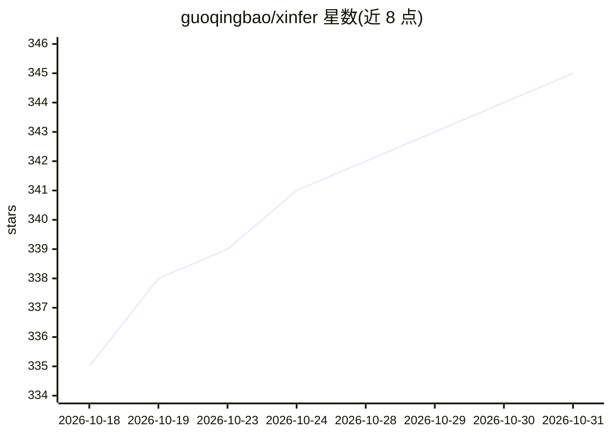

# guoqingbao/xinfer

⭐ 345 · Rust · MIT · 推送 2026-10-30 · [GitHub](https://github.com/guoqingbao/xinfer) · [官网](http://guoqingbao.github.io/xinfer/) · 个人维护 · 中文 README

**纯 Rust 实现的 LLM 推理运行时：无 Python/PyTorch 依赖**

用 Rust 编写的本地 LLM 推理服务：单一二进制提供 OpenAI/Anthropic 兼容 API、内置 ChatGPT 式 Web UI、MCP 工具调用、结构化输出、embedding/tokenizer 端点。核心机制包括 Flash Attention/FlashInfer/CUDA Graphs、连续批处理、前缀缓存、PD 分离、多节点张量并行，以及 TurboQuant 2–4 bit KV 压缩（宣称扩展上下文约 4 倍）。支持 Qwen、DeepSeek、GLM、Llama、Gemma 等系列及 Safetensors/GGUF 多种格式；跨 CUDA(Linux/Windows) 与 Metal(macOS)。可选 PyO3 Python wheel。限制：PD 分离 Metal/macOS 需 file/TCP 模式。面向需要自建推理服务的开发者。

## 筛选速览

| 维度 | 判定 | 备注 |
|---|---|---|
| AI 角色 | `ai-ecosystem` | LLM/agent 周边工具 |
| 许可风险 | `permissive` | MIT |
| 部署形态 | `self-host` | docker 或自建部署 |
| 模型依赖 | local-ok | 支持本地模型 |
| 硬件要求 | — | 无带数字的原话,不猜 |
| 安装摩擦 | `low` | 无编译、无系统依赖或容器化 |
| 成熟度 | — | 结构信号不足 |

## 能力要点

- 纯 Rust 后端，零 Python/PyTorch 依赖，核心调度+注意力逻辑 <5000 行
- TurboQuant 2–4 bit KV 压缩，宣称单卡 24/32GB 跑 30B+ MoE 长上下文
- OpenAI/Anthropic 兼容 API、内置 Web UI、MCP 工具调用、结构化输出
- 多节点张量并行（TCP NCCL）与 Prefill-Decode 分离部署

## 适用场景

- 在自有 GPU 服务器上部署 OpenAI 兼容的推理 API
- 消费级显卡运行 30B+ MoE 模型的长上下文推理
- 配合 xbot/OpenCode/Claude Code 等 agent 作为本地推理后端
- 多机多卡分布式推理与 PD 分离部署

## 场景标签

`推理引擎` · 领域:训练与推理

## 证据(README 行号)

> L2:  Blazing-fast LLM inference in pure Rust. No PyTorch. No Python runtime. Just fast, portable, production-ready infer
> L13: |**🏭**|Production-ready|OpenAI/Anthropic-compatible APIs, built-in ChatGPT-style Web UI, MCP tool calling, structur

## 星数曲线

2026-10-18 335 → 2026-10-31 345（+10）

---
*卡片 v1 · prompt 1.4 · 生成 2026-10-22 · 置信度 mid · 依据 README sha `734dccdb6bb8` · [字段定义](../../DATASET.md)*
