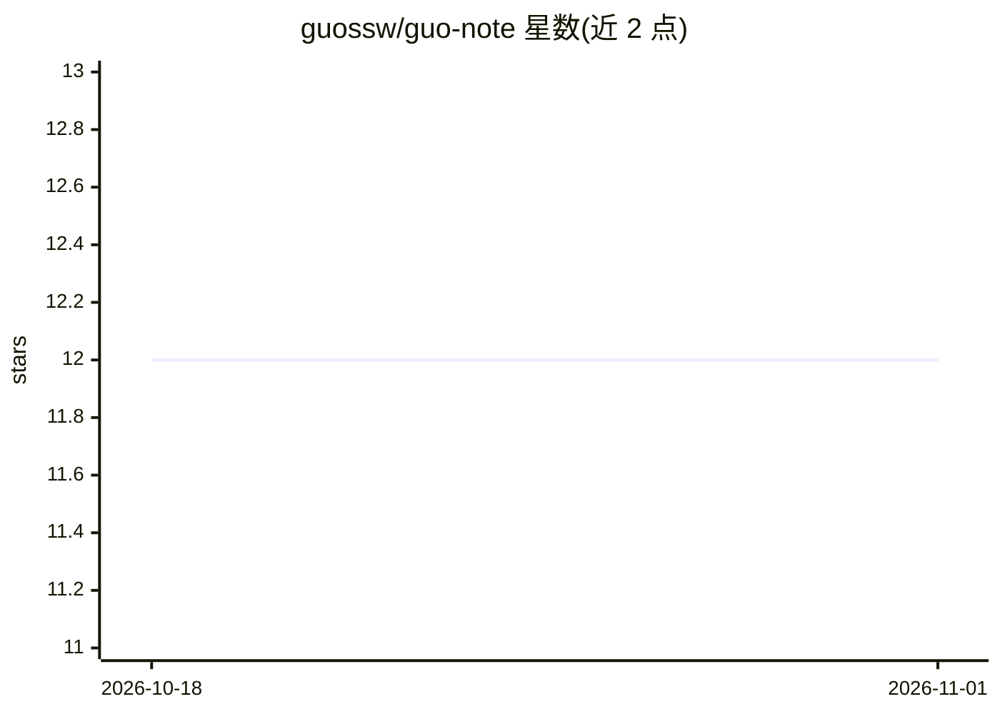

# guossw/guo-note

⭐ 12 · TypeScript · 推送 2026-10-14 · [GitHub](https://github.com/guossw/guo-note) · [官网](https://guo-note.pages.dev/) · 个人维护

**个人学习笔记仓库（README 为空）**

仓库描述为 Guo's learning note，主题标签为 ai、algorithms、protocol，从命名判断为个人学习笔记类仓库。README 内容为空，无可见的功能说明、安装方式、使用方法或项目机制可供核验。无法确认其包含的笔记主题、格式或维护状态。

## 筛选速览

| 维度 | 判定 | 备注 |
|---|---|---|
| AI 角色 | `ai-knowledge` | 知识聚合/清单类 |
| 许可风险 | `none` | — |
| 部署形态 | `None` |  |
| 模型依赖 | — | README 未给出锁定关系 |
| 硬件要求 | — | 无带数字的原话,不猜 |
| 安装摩擦 | `low` | 无编译、无系统依赖或容器化 |
| 成熟度 | — | 结构信号不足 |

## 能力要点

- 仓库描述标注主题为 ai、algorithms、protocol
- README 无内容，无功能或机制说明可核验

## 适用场景

- 无法从 README 确认具体适用场景

## 场景标签

 · 领域:知识记录/学习笔记

## 星数曲线

2026-10-18 12 → 2026-11-01 12（+0）

---
*卡片 v1 · prompt 1.4 · 生成 2026-11-01 · 置信度 low · 依据 README sha `cf4558c7ce21` · [字段定义](../../DATASET.md)*
