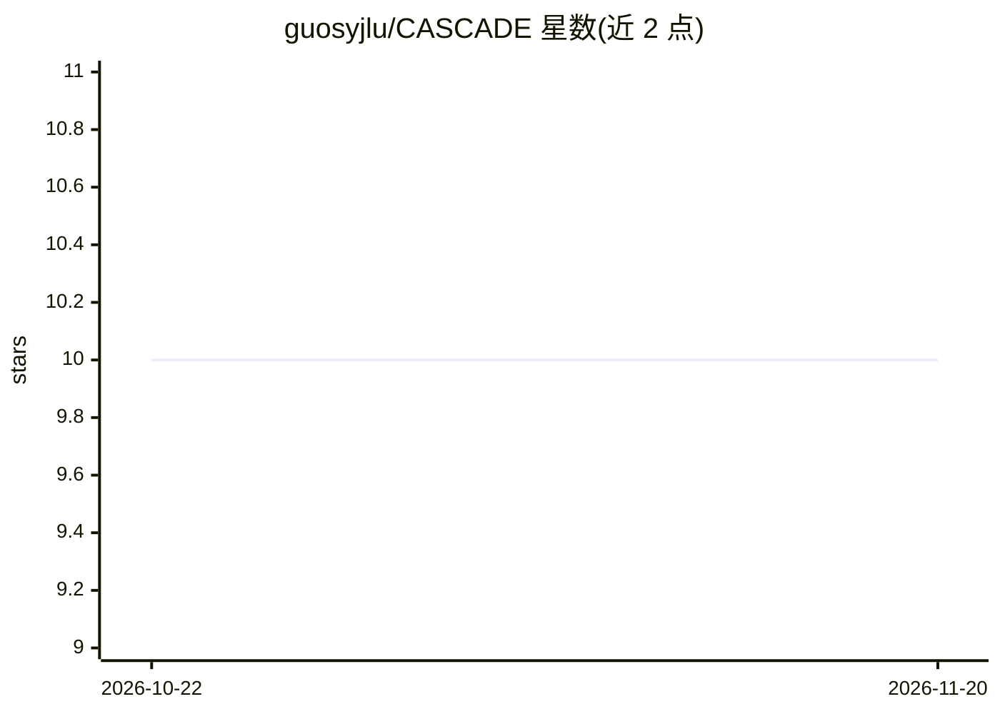

# guosyjlu/CASCADE

⭐ 10 · Python · 推送 2026-05-11 · [GitHub](https://github.com/guosyjlu/CASCADE) · 组织维护 · 中文 README

**LLM 部署期基于案例持续学习的框架，附 DTLBench 基准**

基于案例推理与上下文赌臂算法的研究框架：查询时检索案例、复用并修订生成解答、按奖励更新检索策略，成功案例存入案例库，全程不更新底层 LLM 参数。配套 DTLBench 基准（含 ddxplus、spider、bird、banking77、sentifin 等任务）与论文实验复现脚本；支持通过实现 Env 子类、三个提示模板并注册来接入新任务。提供 conda 环境搭建、HuggingFace 数据下载与 vLLM/OpenAI 两种后端运行方式；受限许可数据集需在 PhysioNet 完成培训后手动下载。

## 筛选速览

| 维度 | 判定 | 备注 |
|---|---|---|
| AI 角色 | `ai-ecosystem` | LLM/agent 周边工具 |
| 许可风险 | `none` | — |
| 部署形态 | `None` |  |
| 模型依赖 | local-ok | 支持本地模型 |
| 硬件要求 | — | 无带数字的原话,不猜 |
| 安装摩擦 | `low` | 无编译、无系统依赖或容器化 |
| 成熟度 | — | 结构信号不足 |

## 能力要点

- 上下文赌臂算法（NeuralLinLogUCB）排序召回案例并在线更新检索策略
- 不更新 LLM 参数的部署期持续学习机制
- 支持 vLLM 本地推理与 OpenAI 兼容 API 两种服务模式
- 提供论文主实验的复现脚本与自定义任务接入流程

## 适用场景

- 在 DTLBench 上复现部署期学习实验
- 把自己的单轮任务接入基于案例的学习流程
- 研究案例库累积对在线策略改进的影响

## 场景标签

`Agent 框架` · 领域:Agent 开发

## 证据(README 行号)

> L1: # CASCADE: Case-Based Continual Adaptation for Large Language Models During Deployment
> L29:  Overview of CASCADE. Given a query, CASCADE retrieves the case via the contextual bandit algorithm, reuses and rev
> L87: - `--agent`: the deployment-time learning method; use `cbr` for CASCADE

## 星数曲线

2026-10-22 10 → 2026-11-20 10（+0）

---
*卡片 v1 · prompt 1.4 · 生成 2026-11-19 · 置信度 high · 依据 README sha `5b702b97a4a4` · [字段定义](../../DATASET.md)*
