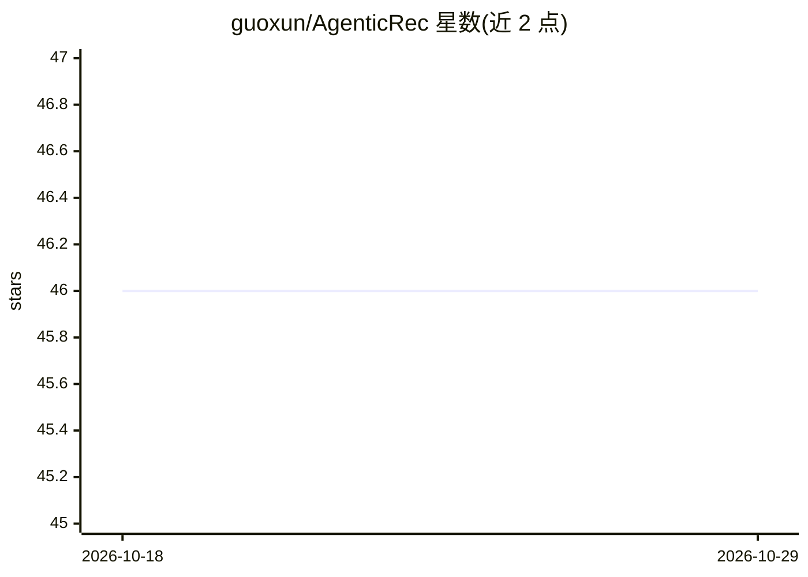

# guoxun/AgenticRec

⭐ 46 · Python · MIT · 推送 2026-06-07 · [GitHub](https://github.com/guoxun/AgenticRec) · 个人维护 · 中文 README

**把搜广推管线重构为多 Agent 议会的轻量级 Python 框架**

面向搜索/推荐系统开发者与研究者的 agentic 框架：将召回-粗排-精排-重排串行管线拆为 RecallAgent、RankAgent、IntentGate、CollaborationAgent、RerankAgent、ExplainAgent、CriticAgent 等角色，由 OrchestratorAgent 路由仲裁。核心代码 <1200 行、无重依赖；LLM 可选（MockLLM 纯规则可跑通），默认 InMemoryVectorBackend 零依赖，预留 Faiss/Milvus adapter。内置 Trace API、请求回放、本地调试服务与零依赖 Bench（3 场景/5 方法/7 指标）。Stage 标注为 Alpha。

## 筛选速览

| 维度 | 判定 | 备注 |
|---|---|---|
| AI 角色 | `ai-ecosystem` | LLM/agent 周边工具 |
| 许可风险 | `permissive` | MIT |
| 部署形态 | `library` | 以包/库形式分发 |
| 模型依赖 | — | README 未给出锁定关系 |
| 硬件要求 | — | 无带数字的原话,不猜 |
| 安装摩擦 | `low` | 无编译、无系统依赖或容器化 |
| 成熟度 | `idea` | |

## 能力要点

- 七个议会角色 + Orchestrator 协调，Agent 持有工具与短期/长期记忆
- 可插拔 VectorBackend（InMemory/Faiss/Milvus/External）
- Trace API 与请求级 Replay，支持本地调试服务 agentic-rec-serve
- 内置 AgenticRec-Bench：3 类场景、5 个方法、7 个指标，无需数据与 API key

## 适用场景

- 用多 Agent 编排重构推荐系统的召回-排序-重排链路
- 冷启动、兴趣漂移等场景的协同议会决策与 A/B 复盘
- 用 Trace 与 Replay 做线上推荐决策的问题定位

## 场景标签

`多智能体` `推荐系统` · 领域:Agent 开发

## 证据(README 行号)

> L3: > **From Pipeline to Council** — 一个把搜索推荐从"管线"重构为"议会"的轻量级智能体框架。
> L21: `AgenticRec` 把这条管线**翻译成五个核心 Agent**，第五阶段加入可插拔 `VectorBackend`，第六阶段新增请求级 `Trace API` 与 `Replay`，让框架从离线 demo 走向可调试服务原
> L116: 3. **工具优先于模型**：搜广推 90% 的复杂度在数据/特征/规则，Agent 只是**编排层**。
> L196: |LangGraph / AutoGen|通用多智能体编排|上游可插拔的 backbone|

## 星数曲线

2026-10-18 46 → 2026-10-29 46（+0）

---
*卡片 v1 · prompt 1.4 · 生成 2026-10-25 · 置信度 high · 依据 README sha `7f5c0cf76743` · [字段定义](../../DATASET.md)*
