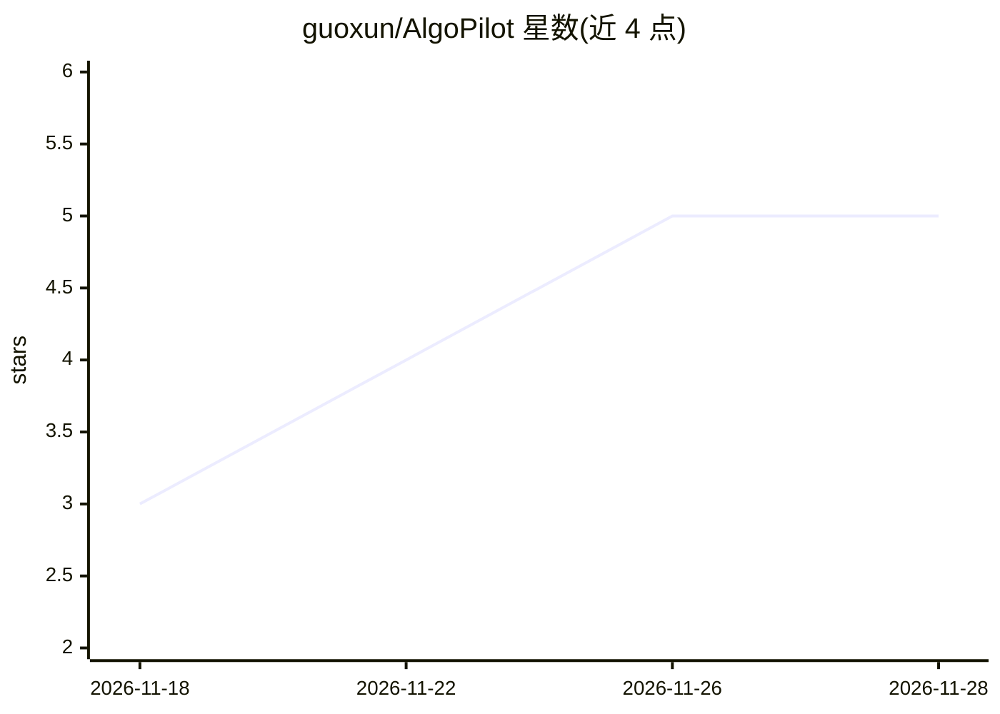

# guoxun/AlgoPilot

⭐ 5 · Python · MIT · 推送 2026-11-14 · [GitHub](https://github.com/guoxun/AlgoPilot) · 个人维护 · 中文 README

**搜广推算法自主迭代组织：LLM agent 在固定评测装置中迭代算法代码**

移植 autoresearch 的"棘轮循环+组织代码"范式到搜广推域：agent 在冻结评测器下自主改写 model.py，经离线棘轮、交付门禁（端到端会话仿真）、上线门禁三道关保留改进。搜/广/推通过 domain.json 契约接入，支持 mock 引擎（零依赖零 API key）与 DeepSeek/智谱等 OpenAI 兼容接口的 LLM 引擎，另有多分支并行（L4）与 program.md 受限自迭代（L5）。Python 运行，人类掌管上线门禁。

## 筛选速览

| 维度 | 判定 | 备注 |
|---|---|---|
| AI 角色 | `ai-ecosystem` | LLM/agent 周边工具 |
| 许可风险 | `permissive` | MIT |
| 部署形态 | `None` |  |
| 模型依赖 | — | README 未给出锁定关系 |
| 硬件要求 | — | 无带数字的原话,不猜 |
| 安装摩擦 | `low` | 无编译、无系统依赖或容器化 |
| 成熟度 | — | 结构信号不足 |

## 能力要点

- 三道关体系：离线棘轮→交付门禁→上线门禁（人类掌管）
- 搜/广/推三域共用 domain.json 契约，引擎不改
- mock 引擎零依赖零 API key 即可跑端到端流程
- L4 多分支并行实验与分叉点结算、L5 组织代码受限自迭代

## 适用场景

- 在搜广推场景中让 agent 自主迭代 CTR 模型并验证交付效果
- 按 30 分钟约定接入自有 train/val 真实数据做算法实验
- 研究离线指标提升与业务交付兑现的对齐问题

## 场景标签

`模型评测` `推荐系统` `编码 Agent` · 领域:编码与开发

## 证据(README 行号)

> L1: # AlgoPilot —— 自驱动搜广推算法迭代智能组织
> L10: 组织代码"范式移植到搜广推算法域,并升级为**可跨域的通用迭代引擎**:
> L42: ## 接真 LLM(DeepSeek / 智谱 GLM 等 OpenAI 兼容接口)

## 星数曲线

2026-11-18 3 → 2026-11-28 5（+2）

---
*卡片 v1 · prompt 1.4 · 生成 2026-11-22 · 置信度 high · 依据 README sha `edd8ca0f624f` · [字段定义](../../DATASET.md)*
