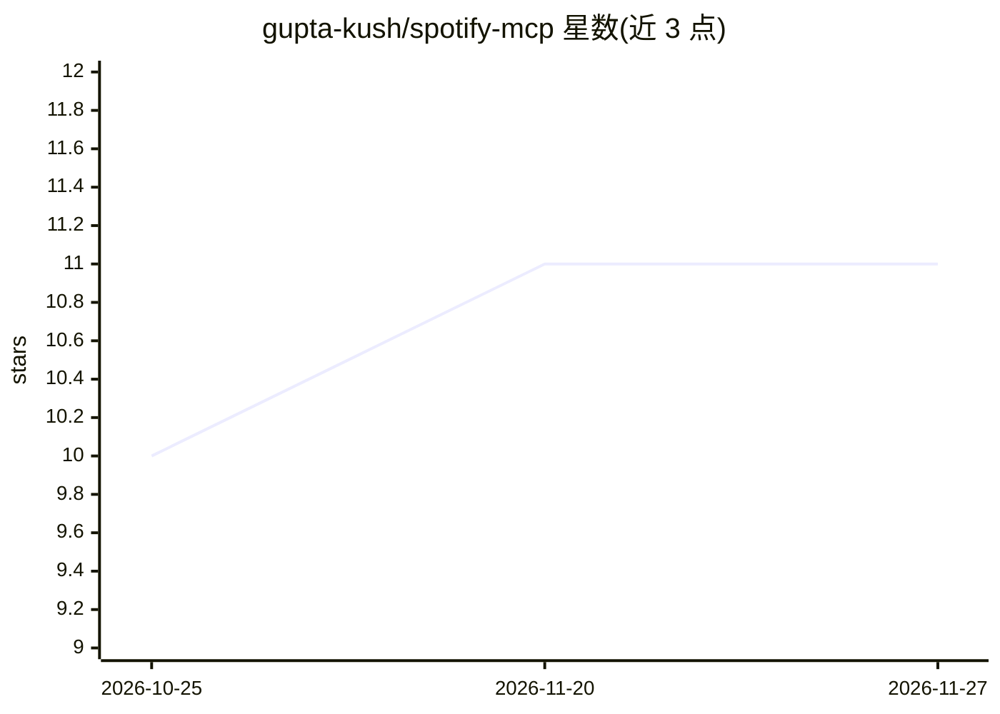

# gupta-kush/spotify-mcp

⭐ 11 · Python · MIT · 推送 2026-03-31 · [GitHub](https://github.com/gupta-kush/spotify-mcp) · [官网](https://pypi.org/project/spotify-mcp/) · 个人维护

**面向 Claude/Cursor 等 MCP 客户端的 Spotify 控制服务器**

一个 MCP 服务器，将 Spotify Web API 封装为 100+ 个工具，供 Claude、Cursor 等 MCP 客户端调用，覆盖播放控制、队列管理、播放列表增删改与合并去重、搜索与发现、听歌统计、智能排序、情绪分析等。默认不加载删除类破坏性工具，开启后默认 dry_run 预览。需用户自建 Spotify 应用获取 Client ID，首次调用经浏览器 OAuth 授权（PKCE，无需 client secret）。通过 PyPI 分发，`uvx spotify-mcp` 即可运行。

## 筛选速览

| 维度 | 判定 | 备注 |
|---|---|---|
| AI 角色 | `ai-ecosystem` | LLM/agent 周边工具 |
| 许可风险 | `permissive` | MIT |
| 部署形态 | `library` | 以包/库形式分发 |
| 模型依赖 | — | README 未给出锁定关系 |
| 硬件要求 | — | 无带数字的原话,不猜 |
| 安装摩擦 | `low` | 无编译、无系统依赖或容器化 |
| 成熟度 | — | 结构信号不足 |

## 能力要点

- 100+ 工具覆盖播放、播放列表、搜索、统计、发现等 16 类操作
- 默认剥离破坏性工具，开启后默认 dry_run 预览
- 支持 --toolsets 按需加载工具集以适配 40 工具上限的客户端
- 本地库索引：同步收藏歌曲到本地 JSON，供 AI 从已有曲库生成播放列表

## 适用场景

- 用自然语言让 AI 帮我播放、搜索和组织 Spotify 音乐
- 批量清理播放列表中的重复和失效歌曲
- 分析我的听歌习惯和口味变化
- 基于自己曲库生成主题播放列表

## 场景标签

`AI 助手` · 领域:对话与助手

## 证据(README 行号)

> L1: # Spotify MCP Server
> L10: Control Spotify from Claude, Cursor, or any MCP client. **100+ tools** for playback, search, playlist management, s

## 星数曲线

2026-10-25 10 → 2026-11-27 11（+1）

---
*卡片 v1 · prompt 1.4 · 生成 2026-11-20 · 置信度 high · 依据 README sha `eeeab2258564` · [字段定义](../../DATASET.md)*
