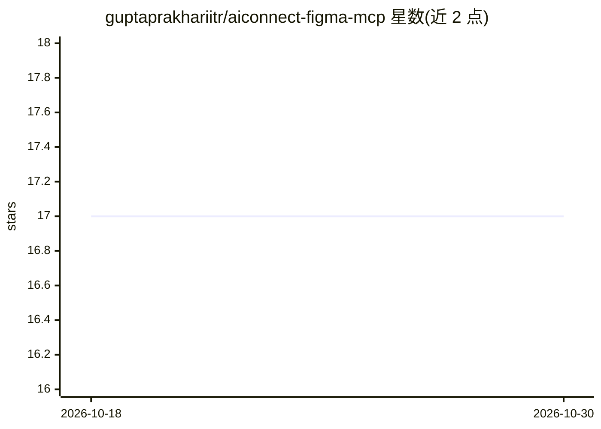

# guptaprakhariitr/aiconnect-figma-mcp

⭐ 17 · JavaScript · MIT · 推送 2026-06-25 · [GitHub](https://github.com/guptaprakhariitr/aiconnect-figma-mcp) · 个人维护

**本地 MCP 服务器+Figma 插件：让 AI 代理直接在 Figma 中作图**

由 MCP 服务器与 Figma 插件两部分组成的开源工具：AI 代理（Claude Code、Cursor 或任意 MCP 客户端）通过 67-69 个工具在真实 Figma 文件中创建帧、文本、渐变、SVG，管理设计变量并导出 DTCG/CSS/Tailwind 令牌；batch_ops 支持在单次往返中组装整页。服务器通过 localhost 中继（端口 3055）与插件通信，无云端、无遥测。需 Node ≥18 与 Figma 桌面版，插件通过 Releases 下载 zip 导入，服务器经 npx 运行，亦可从源码（Bun）构建。

## 筛选速览

| 维度 | 判定 | 备注 |
|---|---|---|
| AI 角色 | `ai-ecosystem` | LLM/agent 周边工具 |
| 许可风险 | `permissive` | MIT |
| 部署形态 | `desktop` | 安装包/桌面程序 |
| 模型依赖 | — | README 未给出锁定关系 |
| 硬件要求 | — | 无带数字的原话,不猜 |
| 安装摩擦 | `low` | 无编译、无系统依赖或容器化 |
| 成熟度 | — | 结构信号不足 |

## 能力要点

- 67 个 MCP 工具覆盖读写、样式、布局、令牌、调试与设计智能
- batch_ops 用 @ref 占位符在单次往返内组装整页
- 全程 localhost 通信，实测 p50 延迟约 0.9ms
- get_css 提供类 Dev Mode 检查，无需付费 Dev 席位

## 适用场景

- 让 AI 代理直接在 Figma 文件里生成落地页与设计版式
- 生成 OKLCH 主题并创建、绑定、导出设计令牌
- 检查选中节点的 CSS 与 WCAG 对比度并自动修复

## 场景标签

 · 领域:设计工具/AI Agent 基础设施

## 证据(README 行号)

> L20: **AIConnect is an MCP server + Figma plugin that hands your AI agent a real pen in your real Figma file.** It creat
> L65: |🤝 **Client‑agnostic**|Use it with Claude Code, Cursor, or any MCP client — not tied to one editor.|
> L214: The **MCP server** (`src/aiconnect_mcp/server.ts`) exposes the tools and runs under plain Node; it also **hosts th

## 星数曲线

2026-10-18 17 → 2026-10-30 17（+0）

---
*卡片 v1 · prompt 1.4 · 生成 2026-10-29 · 置信度 high · 依据 README sha `c6cff1e41d7d` · [字段定义](../../DATASET.md)*
