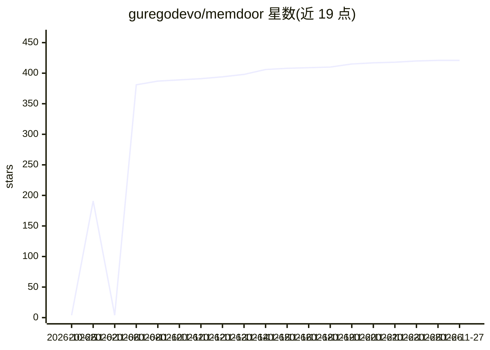

# guregodevo/memdoor

⭐ 421 · Go · Apache-2.0 · 推送 2026-11-26 · [GitHub](https://github.com/guregodevo/memdoor) · [官网](https://memdoor.ai) · 个人维护

**终端里的 Go 语言 coding agent 与工作流运行器，支持本地模型**

Memdoor 是一个单二进制的 coding agent 和工作流运行器：agent 可读取文件、编辑代码并运行检查；工作流以 YAML 定义可复现的步骤图，支持并行任务、审批门、失败断点续跑，可由手动、CI 或 cron 触发。内置决策模型过滤读取内容以降低 token 用量，支持 OpenRouter 等多家 provider、OpenAI 兼容端点，以及通过本地运行时使用开放权重模型。提供终端 TUI、编辑器 ACP 接入、脚本/headless 调用与 GitHub Actions 集成。

## 筛选速览

| 维度 | 判定 | 备注 |
|---|---|---|
| AI 角色 | `ai-ecosystem` | LLM/agent 周边工具 |
| 许可风险 | `permissive` | Apache-2.0 |
| 部署形态 | `None` |  |
| 模型依赖 | local-ok | 支持本地模型 |
| 硬件要求 | — | 无带数字的原话,不猜 |
| 安装摩擦 | `high` | 编译与系统依赖俱全 |
| 成熟度 | — | 结构信号不足 |

## 能力要点

- YAML 工作流：并行步骤、检查通过才完成、审批门与失败续跑
- 决策模型按需筛选读取，宣布示例中输入 token 降低 74%
- /connect local 支持本地运行时，无需 API key
- 内置 GitHub Actions 工作流：pr-triage、pr-review、security-review 等

## 适用场景

- 让 agent 在本地或 ssh 机器上完成修测试、改代码等任务
- 用 YAML 工作流做夜间定时处理 issue 并开 PR
- 在 GitHub Actions 中对 PR 做自动审查与测试编写
- 用本地开放权重模型运行编码任务，数据不出机器

## 场景标签

`编码 Agent` `代码审查` · 领域:编码与开发

## 证据(README 行号)

> L24: Memdoor is a coding agent and workflow runner. Give the agent a task to read
> L60: **Workflows, the deterministic harness.** Say the steps; the coder writes one
> L86: |`/connect`|Add a provider: OpenRouter, Anthropic, OpenAI, Gemini, DeepSeek, Baseten, Groq, xAI, any OpenAI-compati

## 星数曲线

2026-10-25 4 → 2026-11-27 421（+417）

---
*卡片 v1 · prompt 1.4 · 生成 2026-11-25 · 置信度 high · 依据 README sha `7cfdbe9a98f4` · [字段定义](../../DATASET.md)*
